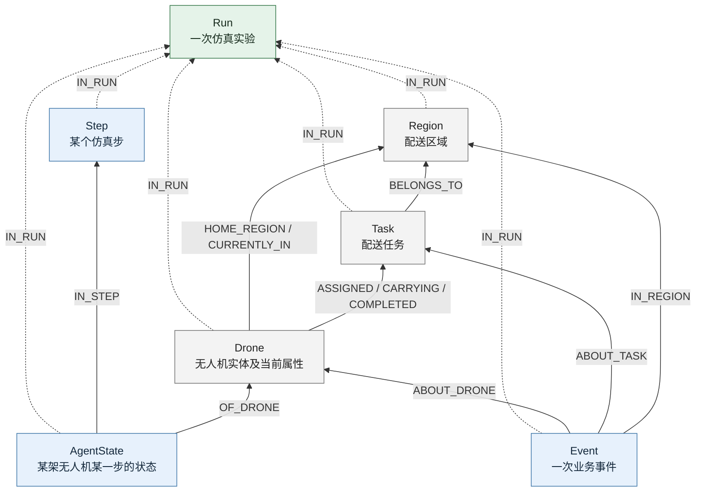

# Neo4j 仿真节点关系结构图

### 任务背景

用一张图解释当前仿真系统写入 Neo4j 的节点类型和关系，回答 Run、Task、Drone 等是并列节点还是上下从属节点。本图依据 `simulation/knowledge.py` 的写入语句，表示节点类型之间的关系，不是数据库所有节点实例的截图，也不穷举其他离线导入工具可能产生的标签。

### 关键结论

- 当前仿真写入 7 种主要节点：Run、Region、Drone、Task、Step、AgentState、Event。
- 在存储上，它们都是独立节点；Run 不是文件夹，其他节点没有物理存放在 Run 节点内部。
- 在业务上，IN_RUN 表示实验归属，BELONGS_TO 表示任务区域归属；分配、携带、完成等关系则表达业务动作。
- AgentState 是某个 drone 在某个 step 的状态，既连接 Step，也连接 Drone，所以整体不是单一父子树。
- Event 表示发生的一次事件，可以关联 Drone、Task、Region；没有关联任务的事件不一定有 ABOUT_TASK 或 IN_REGION 边。
- 图中的箭头是实际关系方向，虚线只为区分 IN_RUN，数据库中并没有“虚线关系”这种额外类型。
- 图表示代码中存在的关系类型，不保证每个节点实例都拥有该类型图上的全部关系。

### 结构图



同一条绘图边中的 `/` 表示合并展示多个不同的实际关系类型。例如 Drone 到 Task 的 ASSIGNED、CARRYING、COMPLETED 是三个关系类型，不是一个带斜杠的关系名，也不表示每个任务同时处于三个阶段。

### 如何阅读

| 节点 | 表示什么 | 与其他节点的核心关系 |
| --- | --- | --- |
| Run | 一次仿真实验的标识 | 其他节点通过 IN_RUN 表达属于这次实验 |
| Region | 一个配送区域，含仓库坐标等 | 任务属于区域，drone 关联区域 |
| Drone | 某次 run 中的一架无人机 | 执行任务，并被多个历史状态引用 |
| Task | 一项配送任务 | 属于区域，与执行 drone 和任务事件关联 |
| Step | 一次仿真推进的步数、时间和汇总 | 同一步有多个 drone 的 AgentState |
| AgentState | 某个 drone 在某一步的状态快照 | IN_STEP 指向 Step，OF_DRONE 指向 Drone |
| Event | 分配、取件、完成、充电等一次事件 | ABOUT_DRONE 指向 drone，任务事件还关联任务及区域 |

例如 drone-7 在 step 2300 携带 task-42：

```text
AgentState(run-A, drone-7, 2300) --IN_STEP--> Step(run-A, 2300)
AgentState(run-A, drone-7, 2300) --OF_DRONE--> Drone(run-A, drone-7)
Drone(run-A, drone-7) --CARRYING--> Task(run-A, task-42)
Task(run-A, task-42) --BELONGS_TO--> Region(run-A, region-2)
```

到 step 2301，会写入另一个 AgentState，仍关联同一个 Drone。Drone 本身不是每一步新建一份；增长到百万级的主要是状态快照，而不是百万架无人机。

### 并列与从属的区别

把 Region、Drone、Task、Step 等看作同一 run 下的不同业务对象，有助于理解归属。但它们之间还存在大量横向联系，因此不能严格画成 Run → Region → Drone → Task → Step 这样的单链层级。

一个 AgentState 同时回答两个问题：“这是哪个 drone 的状态？”和“这是哪个 step 的状态？”这正是 OF_DRONE 和 IN_STEP 两种边并存的原因。

箭头不是强弱级别或查询的强制顺序。例如 `(a)-[:IN_RUN]->(r)` 的方向是状态指向实验，业务含义是“状态属于实验”，并不表示实验是状态的下级。查询也可以沿关系反向匹配，或通过属性索引直接定位 AgentState。

### 当前实现边界

- AgentState 中有 region_id 属性，但该写入路径没有直接建立 AgentState → Region 的关系。
- 当前没有 AgentState → Task 的直接关系，也没有相邻状态或 Step 之间的 NEXT 边。
- Event 有 time_minute 属性，但当前写入路径没有 Event → Step 的直接关系。
- `_write_drone_event` 对充电等无人机事件只建立 ABOUT_DRONE 和 IN_RUN；task_id 为 null，也没有直接 IN_REGION 边，虽然事件保存 region_id 属性。
- `_write_agent_states` 可以创建 Drone，但没有在该段单独建立 Drone → Run；该边由事件写入路径补充。因此图上的边类型存在，不代表每个新建 Drone 立即拥有完整归属边。
- CARRYING 在完成后保留，active 被设置为 false；ASSIGNED 也不会因完成就自动删除。判断当前阶段需要结合关系属性和 Task.status，不能只看是否有边。
- HOME_REGION/CURRENTLY_IN 表示代码采用的区域关联；当前写法 MERGE 新关系，没有在这段代码中自动清理旧区域关系。如果将来支持跨区域移动，要额外定义关系更新规则。

### 执行过的操作

- 阅读 `simulation/knowledge.py:240` 附近的 Step/AgentState 写入。
- 阅读 `simulation/knowledge.py:313` 附近的任务事件及实体写入。
- 阅读 `simulation/knowledge.py:466` 附近的无人机事件写入。
- 使用 rg 核对全部 MERGE/CREATE 关系语句。
- 未访问或修改数据库；本图依据当前代码，不是对数据库实例完整性的一次审计。

### 修改内容

仅新增本文档及 Mermaid 结构图，未修改业务代码、索引或实验结果。

### 后续建议

- 理解当前查询时，把“节点自身属性过滤”和“沿图关系访问”区分开。
- 历史 step 的位置、电量等优先读取 AgentState，任务历史还需要事件或额外的状态版本支持。
