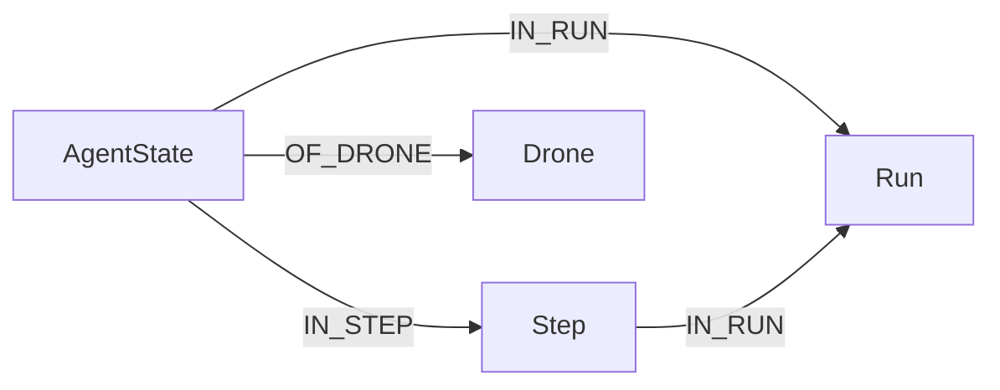
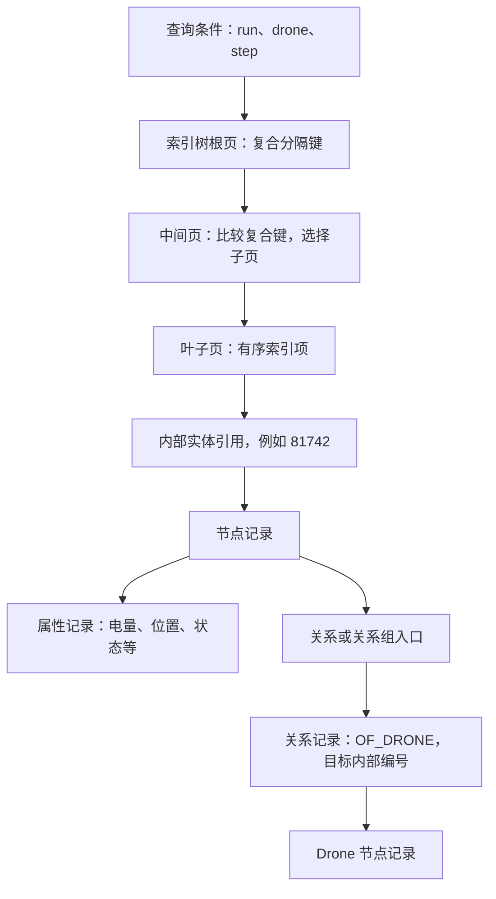

# 图数据、属性索引与实际查询全过程

### 任务背景

解释当前 LaDe Neo4j 查询如何执行，图节点、属性、关系和索引如何存储，以及索引如何定位图数据。采用项目真实 i1 查询及 2026-09-14 保存的 PROFILE 证据。

### 关键结论

- 本次在线只读查询确认 `neo4j` 和 `system` 均使用 `record-aligned-1.1`，下文按 record/aligned 存储讲解。
- 图数据以二进制节点记录、关系记录、属性记录等保存；`AgentState`、`Run` 是标签，不是各自独立的 SQL 表。
- 当前三个 RANGE 索引使用 `range-1.0`，是数据库管理的原生有序树索引；索引页与图里的业务节点是不同对象。
- 索引项在逻辑上建立“属性值组合 -> 内部实体引用”的映射。内部引用使存储引擎直接定位节点记录，无需拿业务字符串 id 再扫描全库。
- 复合键按属性声明顺序比较，但树的每一层并不分别对应 run、drone、step；每层使用复合分隔键选择子页。
- 之前保存的 i1 PROFILE 是“索引输出 2300 条候选 -> Top 选 1 条 -> 读取该条的其余属性”。不能解释成“只查一次树就直接返回一条完整节点”。
- 磁盘文件按页面访问，图数据和原生索引都可缓存在 page cache 中。DB Hits 不是物理磁盘读次数。

## 1. 当前图数据如何保存

运行中的程序写入这些实际关系，见 `simulation/knowledge.py` 的 `_write_agent_states()`：



这是逻辑图结构。磁盘上没有一张“图图片”，也不是把一个 Run 对象及其所有下属对象嵌套为一个大 JSON。

对于本库的 record/aligned 格式，存储可概念化为：

| 内容 | 主要记录信息 |
| --- | --- |
| 节点记录 | 是否使用、标签信息或其引用、首个属性记录引用、关系或关系组入口 |
| 属性记录 | 属性键的内部编号、类型、编码后的值、必要的后续记录引用 |
| 动态值记录 | 无法直接放入属性记录的长字符串、数组等 |
| 关系记录 | 起点和终点内部编号、关系类型编号、属性入口、遍历链相关引用 |
| 关系组记录 | 高连接度节点按关系类型和方向组织关系入口 |
| Token 存储 | `AgentState`、`OF_DRONE`、`step_index` 等名称与内部编号的对应关系 |

典型记录存储文件包括 `neostore.nodestore.db`、`neostore.relationshipstore.db` 和 `neostore.propertystore.db`；这些是记录存储的文件名示例，本次没有检查服务器数据目录的实际文件清单。

短值可以紧凑编码，长值可能需要额外记录。节点的一组属性可能占用多条记录；不能假设“一条属性恰好一次磁盘读取”。具体字段字节长度取决于存储格式，不套用旧版教程的固定数字。

[官方存储格式说明](https://neo4j.com/docs/operations-manual/current/database-internals/store-formats/)区分 record/aligned 和企业版 block：block 可以将更多属性和关系信息与节点放在一起，不能把本例的记录布局推广到所有版本。

## 2. 索引保存在哪里，是否是一张表

数据库同时维护索引定义和索引内容：

- 定义描述名称、标签、属性顺序、类型和 provider，属于 schema 元数据。
- 内容保存在数据库管理的索引文件中，组织成树页面。

`SHOW INDEXES` 用表格呈现元数据，不代表所有索引条目存放在一张用户可查询的 SQL 表里。

当前第一组索引的逻辑内容可以画成以下表格，编号全部是说明用的假设值：

| 复合属性值 | 指向的内部节点编号 |
| --- | ---: |
| `(R, drone-1, 2298)` | 81001 |
| `(R, drone-1, 2299)` | 81307 |
| `(R, drone-1, 2300)` | 81742 |
| `(R, drone-1, 2301)` | 82116 |

这里的表格只是表示映射关系。实际存储是编码后的键和实体引用；实体编号还可参与区分同属性值的不同节点，不能把它理解成数据库内一定存在独立的“键列”和“值列”。

每个索引有自己的树结构。三组复合索引可能引用同一个 AgentState 的内部编号，节点本体仍只有一份，索引中的属性值则会有额外副本。

## 3. 树怎样关联到图节点



内部编号与业务属性 `a.id`、`drone_id` 不同，也不能把它直接等同于 Cypher 返回的 `elementId()` 字符串。内部记录编号用于引擎定位，不应作为业务永久标识。

在记录存储中，引擎按记录布局把编号换算成文件内的页号和页内记录位置。随后通过页面游标读取对应记录。索引指向的是可解析的实体引用，不是 Python 对象指针，也不要求记录在内存中具有永远不变的地址。

## 4. 实际查询：i1

来源：`scripts/lade_llm_context_queries.py:53`。下方保留实际查询全部返回字段。

```cypher
MATCH (a:AgentState {run_id: $run_id, drone_id: $drone_id})
WHERE a.step_index <= $step_index
RETURN a.step_index AS step_index,
       a.time_minute AS time_minute,
       a.drone_id AS drone_id,
       a.region_id AS region_id,
       a.x AS x,
       a.y AS y,
       a.status AS status,
       a.queue_len AS queue_len,
       a.onboard_count AS onboard_count,
       a.battery_remaining_m AS battery_remaining_m,
       a.total_distance_m AS total_distance_m
ORDER BY a.step_index DESC
LIMIT 1
```

此前真实执行参数：

```text
run_id = million-nodes-hangzhou-0621-100agents
drone_id = drone-1
step_index = 2300
```

### 第一步：客户端发送请求

Python driver 从连接池取得 Bolt 连接，把查询文本和参数分别编码并发送。参数不会要求应用先找到某个 Run 对象。连接不足时这一阶段可能等待。

### 第二步：解析和规划

Neo4j 获取可复用的有效执行计划，或解析、检查语义并生成新计划。规划器根据标签、谓词、已有索引和统计信息决定访问路径。查询代码行序不等于执行顺序，索引存在也不保证每条查询都采用它。

本例已保存的 PROFILE 选择了 `lade_agent_state_run_drone_step`。

### 第三步：形成索引检索边界

`NodeIndexSeek` 将条件交给索引读取器：第一维等于指定 run，第二维等于 `drone-1`，第三维不大于 2300。匹配项在复合键顺序上形成一个连续区间。

比较键时先比 run，相同再比 drone，仍相同再比 step。索引树每层都可以比较完整或用于分隔的复合键；没有“第一层是 Run 节点，第二层是 Drone 节点”的固定结构。

### 第四步：读取树页并定位叶子

读取根页，用页内分隔键选择一个子页，重复直到叶子。在叶子内定位所需区间的入口，使用游标读取匹配项，必要时转到相邻叶子页。

根页、中间页、叶子页都通过缓存访问。缓存命中直接访问内存；未命中时请求相应文件页面，底层是否真正访问设备还取决于操作系统缓存。无需把整棵树加载到内存。

[Neo4j 内存配置](https://neo4j.com/docs/operations-manual/current/performance/memory-configuration/)明确说明 page cache 同时缓存图数据和索引。

### 第五步：输出候选编号和索引内属性

之前的实际计划输出了 2300 条候选。每条携带实体引用，以及从索引取得并缓存的 `drone_id`、`step_index`。

注意：`a` 在此阶段可以主要表现为内部引用，通常不需要先把 2300 个节点的全部属性构造成完整对象。索引提供属性值可减少图存储访问。[官方索引执行计划示例](https://neo4j.com/docs/cypher-manual/current/indexes/search-performance-indexes/using-indexes/)展示了相应的 `cache[...]`。

### 第六步：Top 选出最新状态

`Projection` 取出缓存的 step，`Top` 消费 2300 条候选，保留 step 最大的一条。Top-1 可以只维护当前最佳候选，无需把全部候选完整排序，但仍需检查输入的 2300 条。

B+Tree 具有有序读取能力，并不意味着当前规划器已将 `ORDER BY ... LIMIT 1` 转换成边界定位后直接取一条。本例必须按实测的 Top 计划解释。

### 第七步：根据选中节点引用读取其余属性

`CacheProperties` 仅接收到一条候选，读取 `time_minute`、位置、电量等 9 个索引之外的属性。存储引擎根据节点编号定位节点记录，再沿属性引用解码需要的值。

这里存在两种不同的“缓存”：计划中的 `cache[a.x]` 表示在当前执行数据中复用已取得的属性值；page cache 保存的是文件页面，二者不能混同。

### 第八步：构造并返回结果

最后的 `Projection` 把值映射成返回列，`ProduceResults` 产出记录。驱动消费结果流并反序列化成 Python 可用的数据，再由业务代码组成 LLM 上下文。

保存的真实结果包括：step 2300、time_minute 约 634、status `delivering`、queue_len 4、battery_remaining_m 12800.0。这里的电量字段是剩余可飞行距离，不是百分比。

### 实测算子摘要

| 数据流顺序 | 算子 | 输出行数 | DB Hits |
| --- | --- | ---: | ---: |
| 1 | NodeIndexSeek | 2300 | 2301 |
| 2 | Projection：读取索引中的 step | 2300 | 0 |
| 3 | Top：保留最新一条 | 1 | 0 |
| 4 | CacheProperties：读取其余属性 | 1 | 9 |
| 5 | Projection：组织返回列 | 1 | 0 |
| 6 | ProduceResults | 1 | 0 |

总计 2310 DB Hits，是逻辑数据库访问计数，不能解释为读取磁盘 2310 次。证据中的页面统计为零，不能据此证明本次测量所有访问都命中缓存。

这份证据来自 2026-09-14，并非本次重新 PROFILE。数据库统计信息或查询改变后，执行计划也可能改变。

## 5. 查询关系时怎样运行

i1 本身没有关系模式，所以它无需访问任何 Run、Step 或 Drone 节点。它筛选的是 AgentState 上的 `run_id` 和 `drone_id` 属性。

可以在取得最新 AgentState 后增加：

```cypher
MATCH (a:AgentState {run_id: $run_id, drone_id: $drone_id})
WHERE a.step_index <= $step_index
WITH a ORDER BY a.step_index DESC LIMIT 1
MATCH (a)-[:OF_DRONE]->(d:Drone)
RETURN a.step_index, d.id, d.status
```

这时典型后续流程是：读取 a 的关系入口，按类型和方向找到 `OF_DRONE` 关系，读取关系保存的目标内部编号，再定位 d 的节点和属性记录。无需拿目标业务 id 在全部 Drone 中重新搜索。高连接度节点可经关系组访问；遍历成本仍受待检查关系数量影响。该扩展示例本次未执行，具体算子应以其 EXPLAIN/PROFILE 为准。

## 6. 新数据如何同步到索引

仿真提交新 AgentState 时，Neo4j 维护图记录和适用的索引条目；本项目的三个复合索引各增加相应映射。索引键变化需要删除旧键、加入新键，非索引属性变化通常不需要重建这三棵树。

索引更新与事务提交、事务日志和恢复流程配合，页面持久化受日志和检查点机制保护。不能把“提交成功”理解成每个涉及的数据页已经分别同步写盘，也不能把每次 step 理解为再次扫描全库建索引。

### 执行过的操作

- 阅读 `scripts/lade_llm_context_queries.py` 中 i1 和相关查询。
- 阅读 `simulation/knowledge.py` 中索引初始化、AgentState 写入、属性定义和图关系建立逻辑。
- 通过 `./run_in_lade.sh python` 和 JSON 解析器读取 `docs/codex_notes/2026-09-14-agent-state-index-evidence/after.json`，核对参数、真实结果和逐个算子。
- 通过 `./run_in_lade.sh python` 连接本机 Neo4j 执行只读 `SHOW DATABASES YIELD name, store RETURN name, store`，确认实际格式。
- 查阅本文链接的 Neo4j 官方存储、索引、缓存及执行计划资料。

### 修改内容

新增本说明文件；未修改业务代码或数据库数据、索引。

### 后续建议

- 后续优化 i1 时重点检查是否能减少 Top 之前读取的历史候选，不能仅用“已走索引”判断优化完成。
- 继续保持“最新不晚于 step”的语义；改为 step 等值查询前需先决定如何处理缺失快照。
- 测量端到端延迟时，同时区分连接池等待、查询执行、结果传输与消费；DB Hits 单独不能解释所有延迟。
