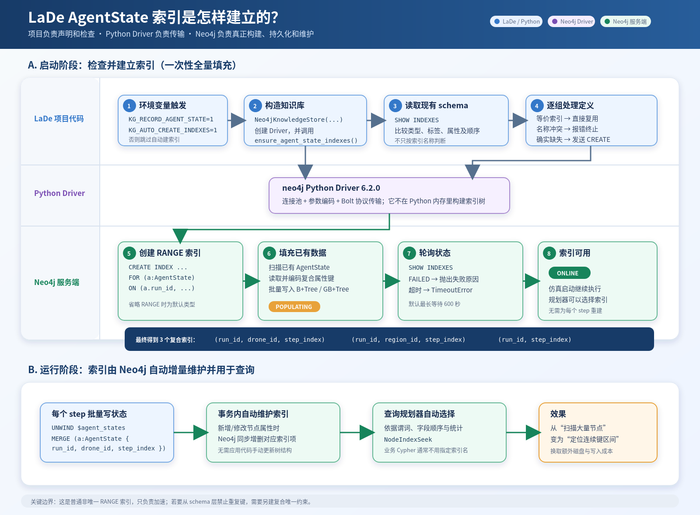

# AgentState 索引建立流程图

### 任务背景

用户希望把 AgentState 索引从启动检查、首次建立到运行期维护与查询使用的过程，用一张图直观展示。

### 关键结论

- 流程图分为启动阶段和运行阶段两部分。
- 启动阶段展示环境变量触发、读取现有索引、复用或创建、Neo4j 填充历史数据、轮询至 `ONLINE` 的完整链路。
- 运行阶段展示每个 step 批量写入、Neo4j 事务内维护索引、查询规划器选择 `NodeIndexSeek` 的过程。
- 图中用蓝、紫、绿三种颜色区分 LaDe 项目代码、Python Driver 和 Neo4j 服务端职责。
- 同时提供 PNG 预览版和可无损缩放、继续编辑的 SVG 源文件。

### 执行过的操作

- 根据 `simulation/knowledge.py` 中的实际调用链设计流程图。
- 使用 SVG 绘制两阶段泳道图和三层职责划分。
- 使用 Firefox headless 将 SVG 渲染为 PNG，并进行视觉检查。
- 修正三个复合索引字段在深色背景上的文字对比度。

### 修改内容

- 新增 `docs/codex_notes/09/28-AgentState索引建立流程.svg`：可编辑的矢量流程图。
- 新增 `docs/codex_notes/09/28-AgentState索引建立流程-final.png`：经过视觉检查的 PNG 预览版。
- 新增本文档，记录图示内容和生成结果。

### 后续建议

- 日常查看或插入文档时使用 PNG；需要放大、改色或调整内容时使用 SVG。
- 如果后续增加唯一约束、更多索引或人工迁移索引，可在 SVG 中继续扩展为数据库 schema 生命周期图。

