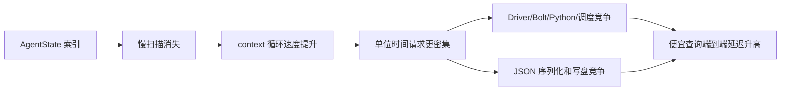

# Neo4j 索引查询时间差异：从“部分查询反而变慢”到瓶颈转移

### 任务背景

在 LaDe 百万级知识图谱上，对同一份 `hangzhou-0621-headless-002` 数据建立无索引 `lade` 和带 AgentState RANGE 索引 `lade-index` 两个 Neo4j 对照库。原始 100 并发混合实验显示整体吞吐提升约一个数量级，但 i0、i3、i4、i5 等不直接访问 AgentState 的查询在带索引库中反而显得更慢。本汇报通过混合负载、受控负载和分阶段计时三组证据，解释这一表面矛盾。

### 关键结论

- AgentState 索引对相关查询的 Neo4j 服务端执行有极大促进：分阶段实验中服务端平均耗时从 `1244.413 ms` 降到 `11.914 ms`，约快 `104.45×`。
- 整轮墙钟时间只改善约 `9–11×`，是因为索引消除数据库扫描瓶颈后，瓶颈转移到高并发的 Driver/Bolt/Python 调度与 JSON 日志写入。
- i0、i3、i4、i5 在原始混合实验中的“反向变慢”不是索引直接退化，而是负载生成方式造成的请求到达节奏差异：无索引的慢查询发挥了“自限流”作用，而带索引库会形成更密集的请求波。
- 受控实验只执行 i0/i3/i4/i5 时，单并发两库绝对差都小于 `1 ms`；100 并发两轮中，带索引库的平均吞吐反而高 `11.6%`，且两库的 EXPLAIN 执行计划完全相同。
- 分阶段数据进一步证明：i0/i3/i4/i5/i9 在带索引库中的服务端时间全部变快，但客户端端到端时间被非服务端开销覆盖。
- 当前 `all` 实验中 i2 因 Cypher `BETWEEN` 语法错误全部失败；延迟汇总排除它，但 QPS 仍将失败请求计入，正式报告需要明确注明。

## 组会汇报正文（建议 8–10 分钟）

### 第 1 页：问题与一句话结论

**研究问题**

1. AgentState 索引能否提升完整 LLM context 查询的速度？
2. 为什么整体快了约 10 倍，i0/i3/i4/i5 却一度显得更慢？

**一句话结论**

> 索引没有让这些查询的 Neo4j 执行变慢；索引消除了数据库扫描瓶颈，使高并发客户端、Bolt 通信与日志写入成为新瓶颈，从而产生了部分廉价查询的端到端延迟反转。

**讲述提示**

> 这次工作最重要的不是得到一个加速倍数，而是把“数据库执行时间”与“应用端等待时间”区分开。表面上的单查询反转，并不代表索引优化失效。

---

### 第 2 页：数据与索引设计

**对照库**

| 组别 | 容器/端口 | 数据 | 实验索引 |
|---|---|---|---|
| 无索引 | `lade` / `57687` | 同一 run，百万级节点 | 无 AgentState 实验索引 |
| 带索引 | `lade-index` / `61687` | 同一 run，内容一致 | 3 组 AgentState RANGE 索引 |

**三组复合索引**

```text
(run_id, drone_id, step_index)
(run_id, region_id, step_index)
(run_id, step_index)
```

**索引直接相关查询**

- i1：查找单个 drone 最新历史 AgentState。
- i6/i7：先定位 self，再查询同 region/step 状态。
- i8/i10：先通过 AgentState 定位区域，再查 Task/Event。
- i11：按 run+step 聚合 AgentState。

**索引不直接相关查询**

- i0：Drone。
- i3：Drone→Task 关系。
- i4/i5：Event 及聚合。
- i9：Step。

**讲述提示**

> 两个数据库的返回结果已做过逐 context 校验，结果一致，因此性能差异不是数据语义不一致造成的。

---

### 第 3 页：三步实验如何逐步定位原因


| 实验 | 回答的问题 | 主要指标 |
|---|---|---|
| 混合高并发 | 完整 context 系统是否更快？ | wall time、QPS、context latency |
| 固定查询组合 | 索引是否直接拖慢无关查询？ | 相同负载下的单查询延迟和计划 |
| 分阶段计时 | 时间到底消耗在哪里？ | server time、client time、queue、logging |

**讲述提示**

> 三步实验分别回答系统层、查询层和计时层的问题。不能用混合系统实验中某一类查询的端到端时间，直接推断索引对该 Cypher 的直接影响。

---

### 第 4 页：整体结果——索引显著改善完整 context 吞吐

**原始混合实验两轮结果**

| 轮次 | 无索引 wall | 带索引 wall | 整轮加速 |
|---|---:|---:|---:|
| 第 1 轮 | 306.987 s | 27.787 s | 11.05× |
| 第 2 轮 | 263.971 s | 28.832 s | 9.15× |

**最新分阶段实验**

| 指标 | 无索引 | 带索引 | 改善 |
|---|---:|---:|---:|
| 整轮 wall time | 279.230 s | 30.457 s | 9.17× |
| 报告 QPS | 85.951 | 788.005 | 9.17× |
| 成功查询 client avg | 1252.119 ms | 123.144 ms | 10.17× |
| client p95 | 4660.747 ms | 301.065 ms | 15.48× |
| client max | 13610.440 ms | 653.286 ms | 20.83× |

**讲述提示**

> 两轮原始实验和新的分阶段实验都得到约 9–11 倍的整体提升，说明结论不是某一轮的偶然波动。索引同时将 p95 和最大延迟大幅压低，尾延迟改善比平均值还更明显。

---

### 第 5 页：哪些查询真正从索引受益

| 查询 | 无索引 client avg | 带索引 client avg | 客户端加速 | 服务端加速 |
|---|---:|---:|---:|---:|
| i1 | 1629.304 ms | 83.218 ms | 19.58× | 1298.85× |
| i6 | 3694.296 ms | 88.308 ms | 41.83× | 2514.04× |
| i7 | 3415.900 ms | 85.029 ms | 40.17× | 2844.49× |
| i8 | 1377.236 ms | 70.064 ms | 19.66× | 78.77× |
| i10 | 1460.271 ms | 178.002 ms | 8.20× | 46.45× |
| i11 | 1998.920 ms | 257.271 ms | 7.77× | 188.70× |

**典型特征**

- i6/i7 无索引时虽然最终平均只返回约 1 行，但必须扫描大量 AgentState，服务端平均需要 3.4–3.7 s。
- 建立复合索引后，服务端可以根据 run/drone/region/step 快速缩小候选集。
- 返回行数少不代表查询代价低；关键是为了找到这些行扫描了多少数据。

**讲述提示**

> 服务端加速倍数远大于客户端加速倍数，这是后面“瓶颈转移”的第一个信号。

---

### 第 6 页：表面矛盾——为什么一些查询在带索引库中反而更慢

**原始混合负载中的端到端时间**

| 查询 | 无索引 client avg | 带索引 client avg | 带索引服务端是否变慢 |
|---|---:|---:|---|
| i0 | 9.815 ms | 90.135 ms | 否，服务端快 5.52× |
| i3 | 9.540 ms | 135.321 ms | 否，服务端快 3.08× |
| i4 | 71.426 ms | 183.784 ms | 否，服务端快 2.33× |
| i5 | 70.538 ms | 95.717 ms | 否，服务端快 2.30× |
| i9 | 36.067 ms | 87.730 ms | 否，服务端快 2.88× |

**请求节奏解释**

```text
无索引：
i0 → [i1 慢] → i3/i4/i5 → [i6/i7/... 很慢] → 下一 context
                       ↑ 慢查询自动限流，便宜查询稀疏到达

带索引：
i0 → i1 → i3/i4/i5 → i6/i7/... → 迅速进入下一 context
                       ↑ 100 个 worker 持续形成密集、同步的请求波
```

**因果链**



**讲述提示**

> 原始脚本测量的是客户端从 `session.run()` 到完整读取结果的时间，它不只包含 Cypher 执行，还包含连接获取、Bolt 往返、调度、结果拉取与 Driver 解码。因此服务端变快和客户端某些请求变慢可以同时成立。

---

### 第 7 页：两组关键证据排除“索引直接退化”

#### 证据 1：相同查询组合的受控实验

**单并发：两库基本一致**

| 查询 | 无索引 | 带索引 | 绝对差 |
|---|---:|---:|---:|
| i0 | 1.081 ms | 1.297 ms | 0.216 ms |
| i3 | 1.423 ms | 1.621 ms | 0.198 ms |
| i4 | 21.968 ms | 22.534 ms | 0.566 ms |
| i5 | 21.824 ms | 22.583 ms | 0.759 ms |

**100 并发，两轮交换顺序**

| 指标 | 无索引 | 带索引 |
|---|---:|---:|
| 两轮平均 QPS | 689.714 | 769.962 |
| 带索引相对变化 | — | +11.6% |

两库的 i0/i3/i4/i5 EXPLAIN 计划逐项相同，没有使用 AgentState 索引。

#### 证据 2：分阶段计时

| 指标 | 无索引 | 带索引 |
|---|---:|---:|
| Neo4j server avg | 1244.413 ms | 11.914 ms |
| server/client 占比 | 99.38% | 9.67% |
| client non-server estimate | 7.706 ms | 111.230 ms |
| output write total | 11.468 s | 29.434 s |
| output write / wall | 4.11% | 96.64% |

**表中核心参数的含义**

| 汇报参数 | 来源字段/算式 | 计时含义 | 解读注意 |
|---|---|---|---|
| `Neo4j server avg` | 成功查询的 `server_query_ms` 平均值 | Neo4j/Bolt 报告的 `t_first + t_last`，即服务端准备首条结果和生成剩余结果的 wall time | 包含解析/计划、索引或扫描、过滤、聚合和结果生成；不是纯 CPU 时间 |
| `server/client 占比` | `server_query_ms / client_query_total_ms` | Neo4j 服务端时间占客户端端到端查询时间的比例 | 无索引为 99.38%，表明数据库执行主导；带索引只有 9.67%，表明瓶颈已转移 |
| `client non-server estimate` | `client_query_total_ms - server_query_ms` | 客户端观测到、但不在 Bolt 服务端计时中的组合残差 | 可能同时包含连接池等待、必要时的 TCP/Bolt 建连认证、本机 TCP/Docker 转发、Bolt 往返、Driver 解码、Python/线程调度；无法再精确拆成单项 |
| `output write total` | 主线程追加写 query/context JSONL 的累计时间 | 包含 JSON 序列化、打开文件、追加写入和关闭文件 | 不在单条 `client_query_total_ms` 中，但包含在整轮 `wall_ms` 中，并且会与 worker 查询并行发生 |
| `output write / wall` | `output_write_ms / wall_ms` | 日志写入累计时间相对整轮墙钟时间的比值 | 这是瓶颈诊断指标，不是严格的互斥时间占比；因为写盘与 worker 查询可以重叠，不能把它再与查询时间相加 |

**单条查询的完整分阶段字段**

| 阶段 | 脚本字段 | 开始与结束 | 主要包含内容 |
|---|---|---|---|
| 构造参数 | `params_build_ms` | 调用 `build_params()` 前后 | Python 构造 run/drone/step/time/limit 等 Cypher 参数 |
| 发送查询并等待结果头 | `run_to_header_ms` | 调用 `session.run()` 前，到 `session.run()` 返回 `Result` | 连接池取连接、必要时建连/认证、Bolt RUN 请求与响应、服务端准备首条结果；是多种开销的混合段 |
| 服务端首结果 | `server_available_ms` | Bolt 返回的 `t_first` | DBMS 准备好流式输出首条结果的整数毫秒数；嵌套在 `run_to_header_ms` 中 |
| 拉取全部记录 | `fetch_records_ms` | 开始迭代 `Result`，到全部 `Record` 进入 Python 列表 | 服务端继续生成结果、Bolt PULL、TCP 传输、Driver 解码和 Python 迭代 |
| 服务端剩余结果 | `server_consumed_ms` | Bolt 返回的 `t_last` | DBMS 完成剩余结果流处理的整数毫秒数；嵌套在 `fetch_records_ms` 中 |
| 取得执行摘要 | `summary_consume_ms` | 调用 `result.consume()` 前后 | 结果已拉取后获取 `ResultSummary`；通常极小 |
| 转换 Python 结果 | `row_conversion_ms` | 对原始 `Record` 执行 `row_to_dict()` 前后 | Neo4j Record 转换为可 JSON 序列化的 Python `dict` |
| Neo4j 服务端总时间 | `server_query_ms` | `server_available_ms + server_consumed_ms` | 服务端查询处理的最佳可用近似；不包含客户端连接池、TCP 往返和 Python 转换 |
| 客户端单查询总时间 | `client_query_total_ms` | `session.run()` 前，到结果全部拉取、summary 取得且转换为 `dict` 后 | `run_to_header + fetch_records + summary_consume + row_conversion` 的端到端总时间，不含参数构造和日志写入 |
| 含参数的查询流水线 | `query_pipeline_total_ms` | `build_params()` 前，到结果转换完成 | 比 `client_query_total_ms` 多包含 `params_build_ms` |
| 构造逐查询日志记录 | `record_build_ms` | 构造查询 record 字典前后 | 只是构造内存中的日志对象，不包含 JSONL 写盘 |

**三个差值估算指标**

| 字段 | 计算方式 | 可以用来判断什么 |
|---|---|---|
| `pre_first_nonserver_estimate_ms` | `run_to_header_ms - server_available_ms` | 首条结果前的非服务端组合残差，主要涵盖连接池、必要时建连、Bolt 往返和 Driver/调度 |
| `post_first_nonserver_estimate_ms` | `fetch_records_ms - server_consumed_ms` | 首条结果之后的非服务端组合残差，主要涵盖 Bolt PULL、TCP 传输、Driver 解码和 Python 迭代 |
| `client_nonserver_estimate_ms` | `client_query_total_ms - server_query_ms` | 整条查询的非服务端组合开销，是汇报中主要使用的残差指标 |

由于 Bolt 服务端时间只有整数毫秒，而客户端 `perf_counter()` 保留小数毫秒，很快的查询中差值估算可能出现极小负数。这是取整分辨率差异，不表示真实存在负开销。

**context 和整轮实验级指标**

| 字段 | 含义 | 是否属于单条查询时间 |
|---|---|---|
| `worker_queue_ms` | context job 从提交到线程池，到 worker 真正开始执行的等待时间 | 否，它是 context 调度等待 |
| `session_create_ms` | 创建 Driver Session 对象的时间 | 否；Session 是轻量对象，物理连接通常到首次 `session.run()` 才延迟取得 |
| `session_close_ms` | 关闭 Session/归还资源的时间 | 否 |
| `queries_client_sum_ms` | 一个 context 内所有成功查询的 `client_query_total_ms` 之和 | 是单查询时间的求和，但不含失败的 i2 |
| `queries_server_sum_ms` | 一个 context 内所有成功查询的 `server_query_ms` 之和 | 是服务端时间的求和 |
| `context_total_ms` | worker 开始处理 context，到所有查询结束并关闭 Session | 否，它还包含参数构造、查询间逻辑、失败查询和 Session 开销 |
| `output_write_ms` | 收集线程把 query/context JSONL 追加写入文件的累计时间 | 否，但包含在整轮 `wall_ms` 中 |
| `wall_ms` | 创建线程池、提交所有 job、等待 context、写 JSONL 及线程池退出的整轮墙钟时间 | 否，是系统级总时间 |

**指标包含关系（不要重复相加）**

```text
client_query_total_ms
├─ run_to_header_ms
│  ├─ server_available_ms              ← 嵌套在内
│  └─ pre_first_nonserver_estimate_ms  ← 差值估算
├─ fetch_records_ms
│  ├─ server_consumed_ms               ← 嵌套在内
│  └─ post_first_nonserver_estimate_ms ← 差值估算
├─ summary_consume_ms
└─ row_conversion_ms

server_query_ms
= server_available_ms + server_consumed_ms

client_nonserver_estimate_ms
= client_query_total_ms - server_query_ms
```

**讲述提示**

> 受控实验证明反向差异在相同负载下消失；分阶段计时证明服务端实际上全部变快。无索引时，客户端平均 1252 ms 中约 1244 ms 是 Neo4j 服务端处理；建立索引后，服务端降到约 12 ms，而非服务端组合残差约 111 ms。因此原始反转来自负载和系统管线，而不是索引执行路径退化。

---

### 第 8 页：结论、局限与下一步

**结论**

1. AgentState 复合 RANGE 索引有效，将完整 context 吞吐提升约 `9–11×`。
2. 服务端查询处理平均提升约 `104×`，尤其改善 i1/i6/i7/i8/i10/i11。
3. 部分查询的端到端反转是混合并发下的自限流与瓶颈转移，不是索引直接导致。
4. 优化数据库后，新的主要瓶颈是 Driver/Bolt/Python 高并发管线与 JSON 日志写入。
5. 查询优化应分别报告“服务端执行时间”与“客户端端到端时间”，否则容易得出错误因果结论。

**局限**

- i2 因 `BETWEEN` 语法错误全部失败，完整 `all` 实验尚需修复后重跑。
- Bolt `t_first/t_last` 只有整数毫秒分辨率，是服务端 wall-time 指标，不是纯 CPU 时间。
- 当前客户端公开 API 不能把连接池、TCP 建连、网络、Driver 调度逐项完全拆开。
- `--repeat 20` 增加的是相同静态查询的性能样本，不是上下文内容多样性。

**下一步**

1. 修复 i2：把 `BETWEEN` 改为 `>=` 与 `<=`，使用新输出文件重跑。
2. 增加 `--no-query-log --no-context-log` 对照，分离查询吞吐与 JSON 写盘开销。
3. 分别测试 1/10/50/100 worker，绘制并发度—QPS—p95 曲线，找到管线饱和点。
4. 正式报告采用 ABBA 顺序并单独预热，抵消缓存和时间漂移。
5. 分开报告 server latency、client latency、context latency 和 throughput，避免把不同问题混为一个指标。

**收尾句**

> 这次实验的最终发现是：索引优化成功后，性能问题并没有消失，而是从数据库扫描转移到了应用端管线。正确的优化对象已经从“继续加索引”变成“降低高并发调度和日志输出开销”。

## 1 分钟精简口播版

> 我们在同一份百万级 Neo4j 数据上，对比了无索引和带三组 AgentState 复合索引的两个库。最初发现完整 context 吞吐提升了 9 到 11 倍，但 i0、i3、i4、i5 等查询的客户端耗时反而更高。我们通过两类后续实验排除了索引直接退化：第一，只执行这四条查询时，单并发两库基本一致，100 并发时带索引库的吞吐还高 11.6%，两库执行计划也完全相同。第二，分阶段计时显示 Neo4j 服务端平均时间从 1244 毫秒降到 11.9 毫秒，实际加速约 104 倍。所以真正原因是瓶颈转移：无索引时慢查询自动限流；建立索引后请求密度大幅上升，Driver、Bolt、Python 调度和 JSON 写盘变成主要开销。因此后续优化重点应从继续加索引，转向减少日志、调整并发度并修复 i2 查询。

## 答疑备忘

### Q1：能不能直接说“索引使查询快了 104 倍”？

不能泛化到所有查询。`104.45×` 是 22,000 次成功查询的服务端时间平均比，由 i1/i6/i7 等原本很慢的 AgentState 查询主导。完整系统的 wall-time 加速是约 9–11×。

### Q2：既然服务端快 104 倍，为什么系统只快 9 倍？

因为原有的数据库扫描被消除后，非数据库部分成为主要开销。带索引组的客户端非服务端估算平均为 `111.230 ms`，而服务端只有 `11.914 ms`；日志写入累计时间也接近整轮 wall time。

### Q3：i0/i3 的端到端时间反而更高，是否表明索引占用页缓存导致退化？

当前证据不支持这个结论。在相同查询组合下，反向差异消失；EXPLAIN 计划相同；服务端分阶段时间还变快了。页缓存可能是次要波动因素，但不是已有证据支持的主因。

### Q4：服务端时间是怎么得到的？

通过 Neo4j/Bolt 返回的 `t_first` 和 `t_last`，在 Python Driver 中分别对应 `result_available_after` 和 `result_consumed_after`。两者之和作为服务端处理时间近似。它不包含客户端连接池等待和 Python 结果转换，但不是纯 CPU 时间，且只有整数毫秒精度。

### Q5：当前 QPS 可以直接放进论文吗？

不建议直接作为最终数字。i2 的 2,000 次请求全部语法失败，但被计入 QPS。应先修复 i2，再在禁用详细 JSONL 日志和启用日志两种模式下分别重跑。

### 执行过的操作

- 阅读并交叉核对原始混合负载分析、i0/i3/i4/i5 受控实验分析和分阶段计时分析。
- 重新读取 6 份受控实验 summary，核对单并发、100 并发两轮的 QPS、平均值和 p95。
- 复核分阶段实验的整体、分查询、服务端和日志写入指标。
- 将三类实验按“发现现象—排除直接退化—定位瓶颈”的逻辑整理为 8 页汇报框架。

### 修改内容

- 新增本组会汇报文档：`docs/codex_notes/10/12-查询时间差异原因组会汇报.md`。
- 在“证据 2：分阶段计时”中补充核心参数、单查询完整阶段、差值估算、context/整轮指标和指标嵌套关系的说明。
- 未修改查询脚本、实验结果、Neo4j 数据或索引。

### 后续建议

- 汇报时以第 1、3、4、6、7、8 页为主，若时间不足，第 2 和第 5 页可压缩成一页。
- 对外报告数字时，建议主报“整体 9–11×”，将“服务端平均 104.45×”作为瓶颈转移的解释证据，不要将后者表述为所有查询的系统加速。
- 待 i2 修复、无详细日志对照和并发曲线实验完成后，再将本组会版材料收敛为论文或正式技术报告。
