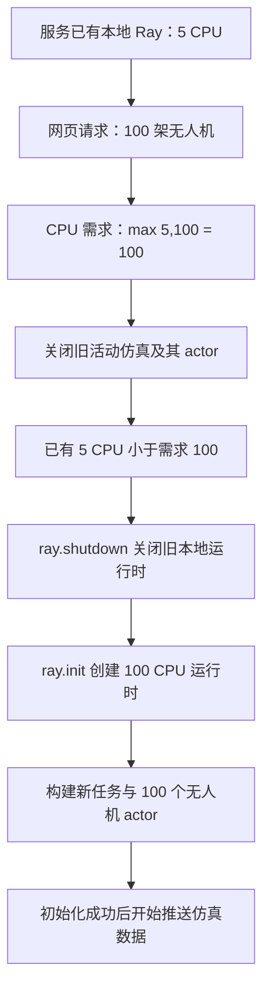

# 网页请求 100 架无人机时的 Ray CPU 参数与重建行为

### 任务背景

用户希望结合当前代码确认：服务启动时 Ray 只有 5 个 CPU 配额，随后在网页端请求 100 架无人机仿真，参数如何计算、集群如何处理、最终会发生什么。

本报告默认使用 `backend=ray`，CPU 指 Ray 逻辑调度配额。主要场景为脚本自己创建本地 Ray，启动时 `ray_num_cpus=5`，网页请求 `drone_count=100`，Ray 地址保持为空。另行分析连接常驻集群及填写 `auto` 的情况。

### 关键结论

- **脚本自建集群的主要路径是：清理旧仿真 → 关闭原来的 5 CPU Ray → 重新以 100 CPU 初始化 Ray → 创建 100 个无人机 actor。** 这是通过重建运行时改变配额。
- 网页 CPU 输入框留空时，后端先继承服务启动值 5，再计算 `max(5, 100) = 100`；网页明确填写 5 时也得到 100，填写 128 时得到 128。
- 每次新 `/events` 请求都会先替换并关闭旧的活动仿真环境；Ray 环境的 `close()` 会逐个终止旧无人机 actor。新仿真重新构造任务与无人机，没有自动读取旧仿真检查点的步骤。
- 资源比较使用 `ray.cluster_resources()["CPU"]`，即集群总逻辑配额。已有 5 小于请求的 100，因此调用 `ray.shutdown()` 后执行 `ray.init(num_cpus=100)`；已有至少 100 时则复用集群。
- 新仿真为每架无人机创建一个 actor，每个明确申请 1 CPU。100 个 actor 总共申请 100 个逻辑 CPU；机器的物理 CPU 数量不随这一参数增加。
- 服务启动参数对象仍保留原来的 5。之后网页改回 5 架无人机时，本次需求计算为 5，但已有 100 大于等于 5，因此继续复用 100 CPU 集群，不自动缩容。
- **常驻集群路径仍有已知错误**：连接已有集群时传入 `num_cpus` 会被当前 Ray 拒绝。脚本不能用上述逻辑修改已有 head 的配额；常见的新服务进程甚至会在网页服务启动前就遇到此错误。
- 已通过隔离验证核对真实源码的参数计算与调用顺序；Ray、仿真构造和推送过程均使用替身，没有重启真实集群、创建真实 actor 或运行实验。

### 执行过的操作

#### 1. 前端如何发送参数

`src/dynamic_app.mjs:272` 的 `buildQuery()` 始终发送无人机数量，但 CPU 和 Ray 地址仅在输入框非空时发送：

```javascript
drone_count: normalizedInt(els.droneCountInput.value, 3)

if (els.rayAddress.value.trim())
  params.set("ray_address", els.rayAddress.value.trim());
if (els.rayNumCpus.value.trim()) {
  params.set("ray_num_cpus", normalizedInt(els.rayNumCpus.value, 1));
}
```

因此，CPU 输入框留空表示“不在请求中覆盖服务启动参数”，并不表示使用 0 CPU。Ray 地址留空也会继承服务启动地址，而不是清除它。运行方式选择“使用服务默认配置”时同理。

#### 2. 后端先继承，再覆盖，最后抬高 CPU 下限

`scripts/run_dynamic_sim.py:440` 的处理过程：

```python
values = vars(base_args).copy()
# 使用网页传入值覆盖相应字段。
# ……
if values["backend"] == "ray":
    values["ray_num_cpus"] = max(
        values.get("ray_num_cpus") or 0,
        values["drone_count"],
    )
```

启动 CPU 为 5、网页无人机为 100 时：

| 网页 CPU 输入 | CPU 覆盖后的值 | 最终需求配额 |
| --- | ---: | ---: |
| 留空 | 继承启动值 5 | 100 |
| 填写 5 | 5 | 100 |
| 填写 100 | 100 | 100 |
| 填写 128 | 128 | 128 |

网页路径还将无人机数量限制在最多 1000 架，当前 100 架不受该上限影响。

#### 3. 先关闭旧仿真，再检查 Ray 资源

`scripts/run_dynamic_sim.py:402` 的实际顺序为：

```python
runtime_args = args_from_request(self.runtime_args, self.path)
# 先发出 HTTP 200 和 SSE 响应头。
# ……
self.replace_active_env(None)
initialize_ray_if_needed(runtime_args)
env, config, depots = build_runtime(runtime_args)
self.replace_active_env(env)
```

`replace_active_env(None)` 会调用旧环境的 `close()`。对于 `RaySimulationEnv`，该方法会遍历旧 actor 并调用 `ray.kill(actor, no_restart=True)`。

因此，即使最后无需重启 Ray，启动新的网页仿真也会替换旧的活动仿真。如果后续 Ray 初始化失败，旧仿真也已经被关闭。

#### 4. 5 CPU 会触发什么分支

`scripts/run_dynamic_sim.py:495`：

```python
requested_cpus = args.ray_num_cpus or getattr(args, "drone_count", None)
init_kwargs = {}
if args.ray_address:
    init_kwargs["address"] = args.ray_address
if requested_cpus is not None:
    init_kwargs["num_cpus"] = requested_cpus

if ray.is_initialized():
    current_cpus = ray.cluster_resources().get("CPU", 0)
    minimum_cpus = requested_cpus or current_cpus
    if current_cpus >= minimum_cpus:
        return
    ray.shutdown()
ray.init(**init_kwargs)
```

代入本例：

```text
requested_cpus = 100
current_cpus = 5
5 >= 100 为假
→ ray.shutdown()
→ ray.init(num_cpus=100)
```

在原集群由该脚本创建、没有指定已有集群地址、也没有其他实例干扰默认发现的情况下，Ray 会停止旧的本地运行时，再创建新的 100 CPU 运行时。启动是否最终成功还取决于运行环境；本次没有真实执行该重启。



Ray 官方说明：`ray.init()` 创建的本地集群会随 `ray.shutdown()` 停止；连接已有集群时，`ray.shutdown()` 只断开客户端连接。[启动与关闭语义](https://docs.ray.io/en/latest/ray-core/starting-ray.html)

#### 5. 新 actor、状态和页面显示

`simulation/ray_delivery_sim.py:376` 将 `_DroneActor` 声明为 `num_cpus=1`，`_create_actors()` 为每个无人机 payload 创建一个 actor；构造函数随后同步获取全部 actor 快照。

主要场景中，新集群配额为 100，新建 100 个各申请 1 CPU 的 actor，可以在 CPU 配额这一项上满足全部 actor。原有任务、无人机状态不会因本次重启自动续接，网页路径会重新执行 `build_runtime()`。

这里的 100 是逻辑配额。Ray 不固定每个 actor 到一个物理核心，也不会创造新的硬件算力。[逻辑资源与物理资源](https://docs.ray.io/en/latest/ray-core/scheduling/resources.html)

页面的 Ray CPU 标签读取 `config.ray_num_cpus`，该字段是本次请求参数，不是实时查询集群资源。若实际已有 128 CPU 并被复用，本次配置标签仍可能显示请求值 100；同理，小请求显示 5 也不意味着集群已经缩为 5。

#### 6. 后续减少无人机数量不会自动缩容

`args_from_request()` 复制的是最初服务参数，不修改 `DynamicHandler.runtime_args`。主要场景启动值为 5，后续请求 5 架且 CPU 留空时，本次需求回到 5，但初始化函数比较 `100 >= 5` 后直接返回，集群仍为 100 CPU。

代码会在资源不足时重建；资源足够时复用。

#### 7. 已有集群和 `auto` 的区别

| 地址及集群来源 | 本次请求的后果 |
| --- | --- |
| 地址为空，原集群是脚本新建的本地实例 | CPU 不足时关闭旧实例，再尝试创建 100 CPU 实例 |
| 指定已有集群的具体地址 | 断开后仍会调用 `ray.init(address=..., num_cpus=100)`，触发已有集群禁止传资源参数的错误；已有 head 保持自身原配额 |
| 填写 `auto`，并且只有刚刚关闭的那一个本地实例 | `auto` 要求找到已有实例，可能直接因为找不到集群而失败，不会主动创建新的本地实例 |
| 已有集群总配额至少 100，且本进程已经初始化 | 资源比较后直接返回，不执行 `shutdown` 或 `init`；但旧活动仿真仍会被替换 |

对于常驻 head，当前代码通常在 `main()` 首次执行初始化时就因“地址 + num_cpus”报错，因此不一定能先正常打开网页服务再走到请求阶段。表中请求阶段的已有集群错误路径，是对能够进入该阶段这一前提的分析。

若后端在发送 SSE 响应头之后初始化失败，异常会继续抛出。前端的 `error` 处理只把状态改为 `reconnecting`，没有关闭 EventSource，因此浏览器可能继续自动重连并重复失败；这属于源码推断，没有实际触发线上故障。

#### 8. 隔离验证

创建并执行临时分析脚本：

```bash
./run_in_lade.sh python /tmp/lade_ray_web_5cpu_100drones_audit_20261021.py
```

脚本用 AST 从当前源码提取真实参数处理函数、初始化函数和 `DynamicHandler`，以替身替换 Ray 模块、仿真构造、HTTP 输出及事件流；不导入并运行服务主入口。首次构造参数时补齐缺失的 `depot_mode` 后，以下验证全部通过：

| 验证场景 | 结果 |
| --- | --- |
| 启动 CPU 5，网页 CPU 留空，无人机 100 | 请求 CPU 100 |
| 启动 CPU 5，网页 CPU 填 5，无人机 100 | 请求 CPU 100 |
| 网页 CPU 填 128，无人机 100 | 请求 CPU 128 |
| 当前 CPU 5，网页请求 100 | 依次记录旧环境关闭、Ray shutdown、init(num_cpus=100)、构造 100 架的新仿真 |
| 当前 CPU 128，网页请求 100 | 复用集群，不调用 shutdown/init |
| 当前 CPU 已为 100，再请求 5 架 | 继续保持 100，无重启 |
| 具体已有集群地址，当前 CPU 5 | 确认会调用 address + num_cpus=100，注入安装版本相同的 API 错误后，异常继续传播，未构造新仿真 |

验证结果保存在 `/tmp/lade_ray_web_5cpu_100drones_audit_20261021.json`。本地安装的 Ray 2.55.1 的 `ray.init` 和 `ray.shutdown` 源码也已只读检查。

**验证边界**：这证明参数计算与 Python 调用顺序，没有证明真实环境中 100 CPU 集群一定能启动。已有集群的异常在替身中按真实 Ray 源码注入，没有连接真实集群进行破坏性验证。

### 修改内容

仅新增本总结文件及 `/tmp/` 中的隔离分析脚本、JSON 结果。未修改业务代码、网页参数处理、现有前端工作文件或 Git 提交；没有启动、关闭或连接真实 Ray 集群。

主要读取文件：`AGENTS.md`、`dynamic.html`、`src/dynamic_app.mjs`、`scripts/run_dynamic_sim.py`、`simulation/ray_delivery_sim.py` 及当前环境的 Ray 初始化/关闭源码。

### 后续建议

1. 如果期望网页启动 100 架时始终限制在 5 个逻辑 CPU 内，需要同时调整每个 actor 的资源申请方式或组织方式，以及网页强制上调 CPU 配额的规则。
2. 如果接受网页通过重建本地 Ray 调整资源，应在界面明确说明新请求会结束旧仿真，并正确反馈初始化进度与失败原因。
3. 若使用常驻 head，应修正连接已有集群时传入节点 CPU 参数的逻辑，并在资源不足时给出明确提示。本次只分析，没有执行上述修改。
