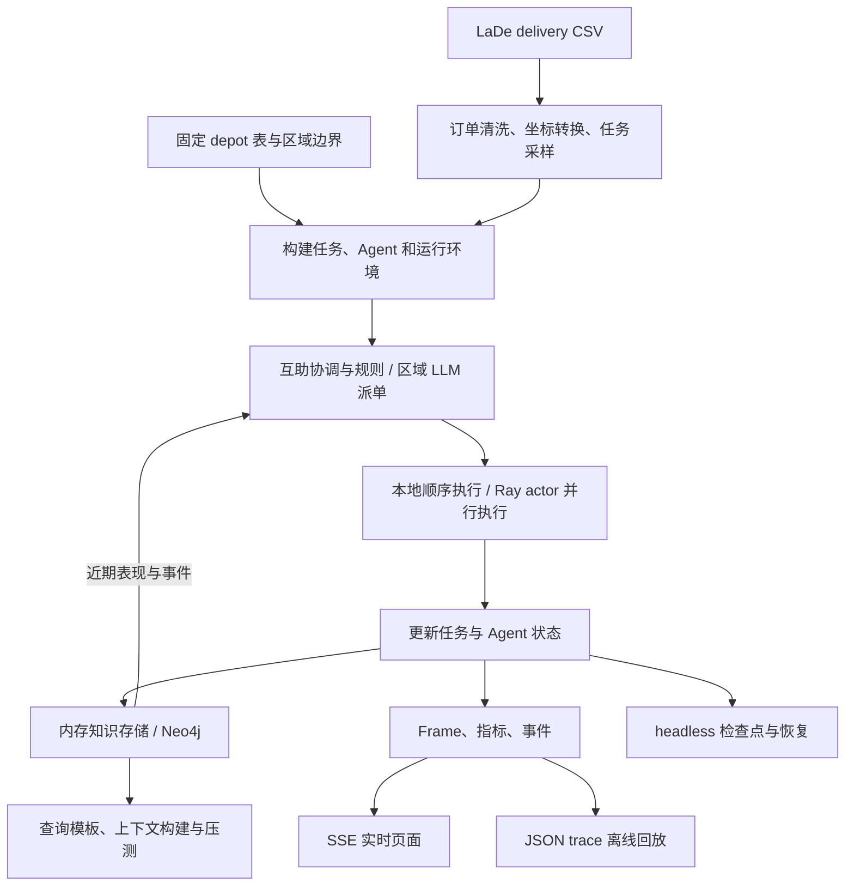
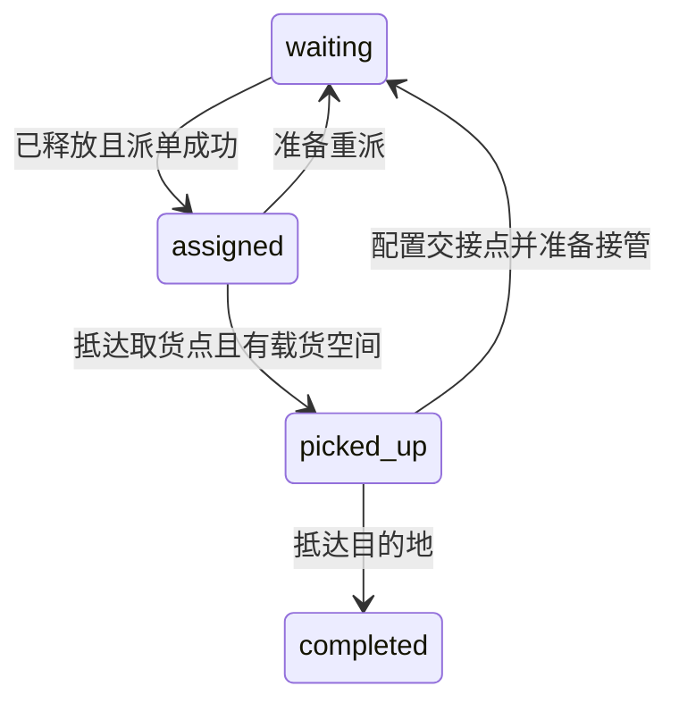
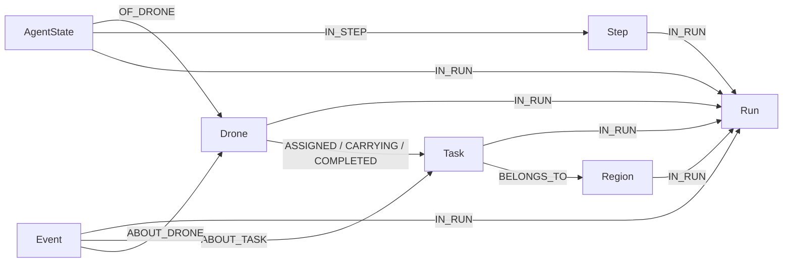

# LaDe 项目架构、代码结构与跨项目复用指南

分析日期：2026-10-26。范围：`/data/zc/datasets/LaDe/viewer` 当前工作区代码，包括尚未提交的前端修改；参考提交为 `6cf3f01`。本文区分“代码已经实现的行为”和“迁移时建议采用的设计”，不代表线上运行状态或性能验收结果。

### 任务背景

用户希望理解当前 LaDe 项目的设计、代码结构和实现方案，并在另一个项目中仿照使用。由于目标项目的业务与技术栈尚未提供，本文先提炼可迁移的模块边界、数据契约和工程方法，再说明 LaDe 专属逻辑及迁移前需要处理的问题。

### 关键结论

- 项目已经是一个多 Agent 配送仿真与知识查询实验平台，包含数据预处理、仿真执行、规则/LLM 调度、时序图谱、查询压测、实时展示和离线回放。
- 最值得复用的是“领域状态 → 调度决策 → 执行动作 → 事件与快照 → 知识查询 → 可视化”的闭环，以及执行、策略、存储三个可替换位置。
- 多 Agent 的执行可以分布到 Ray actor，但任务调度、互助协调和知识写入主要集中在驱动进程；当前不是每个 Agent 独立检索、调用 LLM 并互相通信的架构。
- 内存存储和 Neo4j 存储具有相似调用接口；Neo4j 用 `Run/run_id` 隔离实验，用实体、事件、Step 和 AgentState 分别表示当前属性、过程事实、全局步摘要和单 Agent 历史状态。
- 实时 LLM 调度使用区域上下文摘要；另有 `q0–q55` 通用查询模板和 `i0–i55` 决策上下文查询。这两套查询工具并未自动接入实时 LLM 调度。
- 实时页面以 SSE 接收帧，浏览器缓存历史帧以便回看；headless 模式不保留前端帧，通过检查点和恢复逻辑支持长实验。
- 应迁移架构和接口，并改写数据适配、任务状态、成本函数和约束；当前电量准入行为、旧文档、运行配置和部分可扩展性问题不宜原样复制。
- 本次运行了 102 项相关 Python 单元测试，99 项通过、3 项电量准入相关测试失败；Node 运行的 6 组前端测试全部通过。没有启动真实 Ray、Neo4j、LLM 或完整实验。

### 一、项目定位与设计思路

业务场景是把 LaDe 的真实配送订单转换成虚拟无人机任务：区域仓库取货，再飞往订单目的地。项目同时服务两个目的：观察配送协作行为，以及生成、查询和评估多 Agent 时序知识。

主流程可以概括为：



这张图表达代码中的逻辑关系；当前并没有为每个方框部署一个独立服务。HTTP 服务、中央协调器和知识写入通常在同一个 Python 进程内，Ray 和 Neo4j 才是可选的外部基础设施。

三个核心替换位置如下：

| 替换位置 | 当前实现 | 迁移价值 |
|---|---|---|
| 执行方式 | `SimulationEnv` / `RaySimulationEnv` | 同一业务先本地验证，再增加并行执行 |
| 决策方式 | `RuleBasedPlanner`、`AuctionCoordinator`、`RegionLLMCoordinator` | 保留可解释基线，再引入模型策略 |
| 知识存储 | `TemporalKnowledgeStore` / `Neo4jKnowledgeStore` | 小规模调试无需数据库，大规模实验增加持久化 |

这些替换主要依赖约定的方法和属性，没有统一的抽象基类或 `Protocol`。新项目可以保留这个思路，并把接口正式定义出来。

### 二、代码结构与阅读地图

```text
viewer/
├── simulation/                       核心业务、执行与知识服务
│   ├── delivery_sim.py               Task、Agent、本地环境、拍卖、互助、数据装载
│   ├── planner.py                    成本估计、LLM 请求、区域批量调度与回退
│   ├── ray_delivery_sim.py           actor、状态代理、序列化、Ray 环境
│   ├── knowledge.py                  内存事件、Neo4j 实体/事件/快照写入
│   ├── checkpoint.py                 检查点格式、校验、原子写入
│   └── graph_query.py                手动只读图查询服务
├── scripts/                          入口编排、数据准备、实验与运维工具
│   ├── run_dynamic_sim.py            HTTP、SSE、运行时构建、请求参数
│   ├── build_delivery_sim.py         离线 trace 生成，使用本地环境
│   ├── run_headless_sim.py           无页面长实验、检查点、actor 恢复
│   ├── run_headless_supervisor.py    子进程异常退出后的恢复启动
│   ├── build_summary.py             数据概览统计、通用清洗辅助函数
│   ├── build_fixed_region_depots.py  全量订单预计算固定 depot
│   ├── build_region_boundaries.py    区域边界预计算
│   ├── build_trace_index.py          回放文件索引
│   ├── lade_cypher_benchmark.py      通用图查询并发压测
│   ├── lade_cypher_templates.py      通用查询扩展模板
│   ├── lade_llm_context_queries.py   单 Agent 上下文检索与并发测试
│   ├── lade_llm_context_templates.py 上下文查询、schema 合约与时间语义
│   ├── lade_llm_context_queries_stages.py  查询阶段计时
│   ├── build_neo4j_scale_dataset.py  原始配送数据的大规模图导入
│   ├── backup_neo4j_run.py           按 run 逻辑备份
│   └── copy_neo4j_runs.py            跨实例复制、schema 复制与计数核对
├── src/                              浏览器原生 ES modules
│   ├── app.mjs                       数据概览
│   ├── simulation_app.mjs            离线 trace 回放
│   ├── dynamic_app.mjs               实时页面与状态渲染
│   ├── dynamic_timeline.mjs          浏览器帧历史与回看游标
│   ├── dynamic_query.mjs             手动 Cypher 查询面板
│   ├── dynamic_assistance.mjs        互助状态的显示映射
│   ├── dynamic_regions.mjs           区域轮廓辅助与兜底生成
│   ├── canvas_utils.mjs              Canvas 投影、颜色、缩放和平移
│   ├── ui.mjs                        状态标签、折叠、标签页和 HTML 转义
│   └── styles.css                    页面样式
├── index.html / simulation.html / dynamic.html
├── data/                             预计算表、trace、日志和检查点
├── tests/                            Python unittest 与 Node 测试
├── run_local_sim.sh / run_ray_sim.sh  动态仿真快捷入口
├── generate_res.sh                   trace 生成与索引入口
├── run_in_lade.sh                    项目 Python 环境包装器
└── docs/                             设计、实验和工作总结
```

推荐阅读顺序：

1. [README.md](../../../README.md)：了解入口与配置。
2. [delivery_sim.py](../../../simulation/delivery_sim.py)：先理解领域对象和一步仿真。
3. [planner.py](../../../simulation/planner.py)：理解规则与 LLM 如何替换。
4. [knowledge.py](../../../simulation/knowledge.py)：理解事件记录与上下文读取。
5. [run_dynamic_sim.py](../../../scripts/run_dynamic_sim.py)：理解对象如何被装配并推送到页面。
6. [ray_delivery_sim.py](../../../simulation/ray_delivery_sim.py)：理解本地执行如何改造成 actor 执行。
7. [run_headless_sim.py](../../../scripts/run_headless_sim.py) 和 [checkpoint.py](../../../simulation/checkpoint.py)：理解长实验恢复。
8. [lade_llm_context_queries.py](../../../scripts/lade_llm_context_queries.py)：理解知识查询实验。

### 三、核心对象、状态机与时间推进

#### 3.1 任务与 Agent

`DeliveryTask` 不只是订单坐标，还保存完整的执行状态：释放时间、截止时间、分配者、取货时间、载货者、完成时间、互助原因、交接点和历任执行者等。

主要任务状态：



互助过程会在一次协调调用中重新分配任务，`waiting` 可以只是内部过渡状态；已取货任务改为等待援助机在交接点取货。

`DroneAgent` 保存位置、任务队列、在手货物、累计里程、电量、状态、所属区域、充电仓库与故障/互助标记。几个关键默认值为：

| 参数 | 当前默认值 | 含义 |
|---|---:|---|
| `queue_capacity` | 6 | 接受但尚未完成的任务上限 |
| `cargo_capacity` | 3 | 同时携带的已取货任务上限 |
| `speed_m_per_minute` | 1200 | 每仿真分钟可移动的投影距离 |
| `battery_capacity_m` | 60000 | 用可飞行距离表示满电 |
| `low_battery_threshold_m` | 12000 | 固定低电阈值 |
| `safety_buffer_m` | 5000 | 返回 depot 的安全余量 |

`capacity` 是队列容量的兼容别名。旧字段 `battery_range_m` 仍存在，实际电量推进主要依赖 `battery_remaining_m` 等新字段。

执行时每飞行一米扣除一米电量；先处理可就地取货的任务，在手货物按最早截止时间优先配送。没有在手货物时，再寻找队列中的未取货任务。模型使用直线距离，没有道路导航、避障或碰撞处理。

动态低电阈值为：

```text
max(固定低电阈值, 当前位置到最近城市 depot 的距离 + 安全余量)
```

满足返航条件后锁定目标 depot，到达即充满。`battery_consumed_m` 是当前满电容量与剩余电量之差，充电后会归零；累计飞行工作量应看 `total_distance_m`。

#### 3.2 一步仿真的顺序

本地环境 `SimulationEnv.step_once()` 的实际流程是：

```text
1. 检查互助需求，尝试重派或交接。
2. 选出 release_minute <= now_minute 的 waiting 任务。
3. 调用 coordinator.assign()，记录派单事件。
4. 用 next_time = now_minute + step_minutes 推进所有 Agent。
5. 汇总取货、返航、充电、交接和完成事件。
6. 更新仿真时间，生成并保存 frame。
7. 写入 Step；按配置写入每个 Agent 的 AgentState。
```

这里存在三种独立节奏：`step_seconds` 决定业务时间推进幅度，`wall_interval` 控制入口额外加入的现实时间等待，`frame_stride` 控制实时推送或离线输出的采样密度。它们都不等于实际处理耗时。

一个 tick 内发生的动作通常标记在该步末尾，没有精确的步内到达时间。数据库 Step 从 1 开始，SSE 的 `frame_index` 从 0 开始；前端 `frameStepIndex()` 负责转换，迁移时应统一这个契约。

#### 3.3 数据接入的业务假设

`load_delivery_tasks()` 从 CSV 筛选城市和日期，过滤无效坐标与时间，并支持固定种子的蓄水池采样。`build_region_depots()` 从预计算表读取取货点，不因当前抽样任务不同而重新计算仓库位置。

固定仓库由城市各区域的全量有效订单坐标转换为 EPSG:3857 后取均值得到。初始化 Agent 使用当前任务涉及的 depot；充电候选则包括该城市固定表中的全部 depot。区域边界另外预计算，主要用于展示，不是飞行边界约束。

需要迁移时重新定义的业务含义：

- LaDe 的 `accept_time` 被用作任务释放时间，历史 `delivery_time` 被用作仿真截止时间；这是一种实验映射，不是数据直接提供了承诺时限。
- `parse_minutes()` 保留时分、丢弃日期和秒；`day=all` 也不会因此得到连续多日时间轴。新项目如需要跨日任务，应采用完整时间戳。
- 移动距离使用投影坐标的欧氏距离，电量也使用距离代理；需要真实能耗或精确航程时，应替换对应模型。

### 四、规则调度、LLM 调度与互助

#### 4.1 两级决策职责

`Planner.estimate_cost(drone, task, now)` 回答“某 Agent 接某任务的代价是多少”；`Coordinator.assign(tasks, drones, now)` 决定“这批任务分别交给谁”。

默认拍卖是逐任务的贪心分配：优先选择同区域可接单 Agent，同区没有候选时才扩大到其他区域，选择成本最低者并调用 `assign()`。它不是全局最优匹配或完整路径优化。

规则成本近似为：

```text
到取货点距离 + 取送距离
+ 队列长度 × 1500
+ 预计迟到分钟 × 250
+ 跨区域惩罚 25000
+ 电量缺口 × 10
```

这里的预计时效是简化估计。互助候选另有沿当前队列估算路线距离的函数。新项目应把硬约束、估价和实际路线规划分开，避免把一个加权分数当成可执行性的保证。

#### 4.2 LLM 的实际接入方式

`planner.py` 有两条路径：

| 路径 | 模型输出 | 当前用途 |
|---|---|---|
| `LLMPlanner` | `accept`、`cost`、`reason` | 单 Agent / 单任务估价，可选 |
| `RegionLLMCoordinator` | `assignments: [{task_id, drone_id, reason}]` | 动态页面 `use_llm` 对应的主要路径 |

区域调度按区域汇总任务和可接单 Agent，默认最多选择 20 个任务、10 个 Agent；知识层按截止时间筛任务，并按队列长度、距离筛 Agent。请求中放入任务、Agent、depot 及最近 30 分钟的表现和事件摘要。

请求通过 `urllib.request` 发往兼容接口的 `/chat/completions`，配置模型、`temperature=0` 和 token 上限。响应经过 JSON 解析及 ID、接单条件检查；调用或解析发生异常时，退回规则拍卖。请求、响应、耗时和错误会进入页面及可选的 JSONL 日志。

当前回退边界需要理解准确：异常会触发回退；模型返回空分配、忽略某任务或包含被跳过的 ID，并不必然触发对所有剩余任务的补充分配。区域没有可用同区 Agent 时，这条 LLM 路径也会直接跳过该区域。

此外，当前 coordinator 不只是返回决策，还会修改传入任务和 Agent 的状态。Ray 环境随后会将这些初步决策重新提交给 actor 确认。新项目建议让策略只返回候选决策，再由统一提交层校验唯一归属、容量、时效和能量并修改状态。

#### 4.3 互助已经落到执行逻辑

每轮派单前检查三类情况：Agent 故障、完成任务与安全返航的电量不足、预计无法按时完成任务。候选援助者会排除原执行者和历任执行者，并检查队列、预计路线能量等条件；因 deadline 风险请求帮助时，候选还必须预计能按时完成。

未取货任务可以直接重派；已取货任务把源 Agent 当前坐标保存为交接点，援助者到达后完成新的取货和接管，写入 `task_assistance_requested`、`assist_dispatched`、`task_handover_completed`、`task_taken_over` 等事件。找不到援助者时保留原任务归属；提交失败时有恢复原状态的逻辑。

这是固定交接点模型：原 Agent 释放任务后可能返航，不要求双方持续同步会合。若目标项目需要真实物品交接，应增加双方等待、会合确认和所有权转移的明确阶段。故障处理已有代码，但这不代表项目提供了随机故障生成器。

### 五、本地执行与 Ray 执行

本地环境持有真实的 `DroneAgent` 对象，直接循环调用 `step()`。Ray 环境为每个 Agent 建立一个 `_DroneActor`，actor 内仍然使用相同的 `DroneAgent` 业务代码。

```text
驱动进程：全局任务状态、DroneStateProxy、coordinator、knowledge_store
   │
   ├─ assign.remote(task_payload) → actor 检查接单并返回快照
   │
   └─ 并行提交所有 actor.step.remote(...)
          ↓ ray.get(...) 等待本轮结果
      合并任务状态、Agent 快照和事件
          ↓
      在驱动进程写知识库，形成下一步全局状态
```

可借鉴的实现细节：

- `task_to_payload()`、`drone_to_payload()` 和 snapshot 函数明确对象跨进程的数据表示。
- `DroneStateProxy` 为中央调度提供接近本地 Agent 的接口，减少策略对执行方式的感知。
- actor 拒绝分配时刷新快照，并尝试其他候选，避免只相信驱动进程的旧状态。
- 每个 actor 使用 `num_cpus=1` 的逻辑资源声明；这不等于每架无人机持续占满一个物理核，也不代表真实无人机设备数。
- 测试注入 `FakeRay`，可在不启动集群的情况下检查 actor 创建、接管、拒单重试和恢复逻辑。

扩展限制：每个 tick 仍有同步屏障，调度及知识写入主要串行，且存在多次快照同步和逐任务提交。增加 actor 数量不会自动让全链路按比例加速。新项目应先测量各阶段开销，再决定是否批量提交、减少同步或拆出知识写入服务。

### 六、知识存储与时序图谱

#### 6.1 两种存储后端

`TemporalKnowledgeStore` 是内存事件列表和 Step 摘要列表。它从调用方传入的当前 Task/Drone 生成上下文，没有独立持久化全部实体。

`Neo4jKnowledgeStore` 继承内存实现，同时把事件与状态写入 Neo4j；因此使用 Neo4j 时也仍然保留内存事件。区域上下文中的近期表现和事件改从当前 run 的数据库记录读取。

| 数据层次 | 主要对象 | 适合回答的问题 |
|---|---|---|
| 实验隔离 | `Run`、`run_id`、`IN_RUN` | 属于哪次实验？ |
| 当前实体 | `Drone`、`Task`、`Region` | 当前任务归属、位置、容量与资源是什么？ |
| 过程事实 | `Event` | 何时派单、取货、完成、返航或求助？ |
| 全局摘要 | `Step` | 某一步全局还有多少任务、哪些状态的 Agent？ |
| 历史状态 | `AgentState` | 某个 Agent 在某一步的位置、电量和负载是什么？ |

当前写入器还支持 `ASSIGNED`、`CARRYING`、`COMPLETED`、`ASSISTS`、`HANDOVER_TO`、`TAKES_OVER` 等关系；部分关系通过 `active` 属性标识当前有效性。不能仅根据“关系存在”判断任务仍归属于某 Agent。



#### 6.2 可以直接借鉴的持久化设计

- 实体匹配以业务 ID 加 `run_id` 隔离实验；Step、AgentState 和事件 ID 也含运行身份。
- 事件 ID 由 run、事件类型、时间、Agent 和任务组成，并使用 `MERGE`，支持重复执行时复用事件节点。
- `KG_RECORD_AGENT_STATE=1` 时，一步的所有 Agent 快照以 `UNWIND` 批量写入。
- 按查询条件维护三组 `AgentState` RANGE 索引：`(run_id, drone_id, step_index)`、`(run_id, region_id, step_index)`、`(run_id, step_index)`。
- 启动阶段可以复用同定义索引，创建缺失索引并等待 `ONLINE`；超时、失败或同名异定义会明确报错。

当前实体属性会被后续写入覆盖；完整历史任务归属不能仅靠当前 `Task.assigned_to` 或 `Drone` 属性还原。AgentState 是 Agent 状态快照，也不是每一步的完整任务快照。新项目需要“任意时刻完整回放”时，应另行设计任务版本、有效时间区间或完整事件重建协议。

`CURRENTLY_IN` 等关系的名称也不能直接解释为精确的实时地理归属；其写入逻辑依赖任务区域。迁移时应核对每条关系的实际更新来源。

### 七、查询工具、上下文检索与性能实验

#### 7.1 三种查询用途

| 工具 | 用途 | 与实时调度的关系 |
|---|---|---|
| `GraphQueryService` + 页面查询面板 | 手动输入只读 Cypher，检查图与耗时 | 独立于仿真写入 |
| `lade_cypher_benchmark.py` | 56 个 `q0–q55` 模板，评估点查、时序、协作、异常与质量查询 | 独立实验入口 |
| `lade_llm_context_queries.py` | 56 个 `i0–i55` 查询，为每个 Agent 组织决策上下文 | 生成上下文，当前不会因此调用 LLM |

`i` 系列覆盖自身状态与能力、任务进展、近期记忆、局部协作候选、能量风险、数据新鲜度等，并以 `task_decision`、`energy_safety`、`request_help`、`provide_help`、`recovery` 等查询包组织。查询对象带 `category`、`required_params`、`temporal_scope`；这有助于目标项目明确查询的输入和时间含义。

当前实时调度调用的是 `knowledge_store.query_region_context()`，主要读取当前区域任务/Agent，并查询近期事件与表现；没有调用整套 `i` 查询。若目标项目要实现“Agent 先查知识、再让 LLM 决策、再执行”，需要把上下文查询服务接入决策入口，并设计总检索预算、任务约束和缓存策略。

上下文模板还显式定义了既有实验图的 schema 合约，范围比最新仿真写入器更保守，不假设所有数据都带互助事件和关系。复用时必须根据目标数据更新合约，而不是只改连接地址。

#### 7.2 压测实现与统计口径

压测通过共享 driver、每个并发任务独立 session、`ThreadPoolExecutor` 发起查询。通用压测以单次模板执行为任务；上下文压测以一个 Agent 的一组查询为任务，同一上下文中的查询顺序执行，不同上下文并行。

输出包括逐查询 JSONL、逐上下文 JSONL 和汇总 JSON，记录查询参数、返回行数、成功/失败、延迟、平均值、分位数、类别分组和吞吐量。`lade_llm_context_queries_stages.py` 进一步拆分线程等待、session、结果头、记录拉取、行转换及服务端报告耗时。

迁移时应固定以下口径：

- 单条查询延迟、完整上下文延迟、模型推理延迟、完整决策延迟分别记录。
- 完整消费结果后再结束计时，并保留失败数；当前部分统计均值只针对成功查询。
- 服务端报告耗时和客户端总耗时分别解释；两者的差值只是组合估算，不能直接称为纯网络耗时。
- `agents`、线程池大小、连接池大小和实际同时执行的查询数分别说明。
- 稳定记录 run、step、查询目录版本、参数、数据量、索引状态、硬件和预热方式。

项目目标文档提出了百万图数据、100 个以上 Agent 协同查询和延迟门槛，但这些是目标，不是本文确认已达到的结论。本次没有执行性能压测。

另一个容易混淆的点是：`build_neo4j_scale_dataset.py` 导入原始配送任务与 Courier，生成接受/送达事件；仿真写入器生成 Drone、Step 和 AgentState。这两条造数路径的 schema 不同，查询套件不能不加核对就互换使用。

#### 7.3 手动查询面板的边界

HTTP 提供 `GET /api/graph-query/config` 和 `POST /api/graph-query`。查询服务与仿真存储可分别配置地址；前端展示的 run 提示不会自动给任意 Cypher 加 run 过滤。

实现中有单语句与词法检查、`EXPLAIN` 只读类型检查、READ session、事务超时及回滚；限制请求体、返回行数和结果体积，并限制同时执行一个手动查询。返回体积上限不等于数据库扫描工作量上限。

这适合受信任的本地实验工具。目标项目若向多人开放，应补充身份与运行隔离、数据库只读权限；这些属于部署边界调整，不是现有面板已经提供的能力。

### 八、实时可视化与离线回放

三个页面分别承担不同职责：

| 页面 | 输入 | 展示内容 |
|---|---|---|
| `index.html` | `data/summary.json` | 城市、任务类型、时间分布和样本点 |
| `simulation.html` | `data/traces.json` 与选中的 trace | 已生成结果的播放、拖动和 Agent 状态 |
| `dynamic.html` | `/events` SSE | 当前运行的地图、指标、任务、Agent、KG/LLM 和查询面板 |

实时服务用标准库 `ThreadingHTTPServer` 同时提供静态文件和接口。SSE 的核心事件为：

```text
init        配置、静态任务、depots、区域与初始指标
frame       动态帧、指标、近期 KG 事件和 LLM 事件
done        结束原因、最终指标与摘要
superseded  有新连接启动仿真，本运行被替换
```

当前 `/events` 连接会构建并推进一次仿真；服务保留一个全局 active env，新连接会替换旧运行。连接中断后浏览器重连也不是自动恢复同一次运行。这是交互实验台的生命周期，不能直接当作多用户订阅同一个后台实验的服务。

前端只消费帧和静态任务数据，不自行重算调度。Canvas 负责区域、任务点、取货/交接路线、depot 和 Agent 绘制；表格展示队列、载货、电量、互助和时效。`canvas_utils.mjs` 和 `ui.mjs` 提取了页面间共用逻辑。

`FrameTimeline` 保存本次连接收到的完整 payload 和显示游标，回看时地图、指标与事件一起切换；后端继续推进。“暂停”主要影响前端消费与播放，不是暂停后端。刷新或重启会清空浏览器历史。

可复用的核心协议是把静态对象与动态帧分开，并在帧中包含渲染所需的状态，使同一业务结果既可实时推送，也可保存后回放。但当前帧与浏览器历史没有容量限制，大数据量还会累积已释放任务状态；长运行需要环形缓冲、增量帧或分段落盘。

离线入口 `build_delivery_sim.py` 当前明确使用本地环境和默认内存知识存储，并没有完整复用动态入口的 Ray/Neo4j 装配。新项目建议抽出公共 runtime factory，供在线、离线与 headless 三种入口使用。

### 九、长实验、检查点与恢复

`run_headless_sim.py` 复用动态入口的 `build_runtime()`，通过 `StepCounter` 替代帧数组，并关闭 snapshot 构造，降低展示数据的开销。它仍会保留知识存储中的内存事件和 Step 列表，所以不能据此认为内存完全恒定。

检查点包含版本、run、关键配置、step/time、任务可变状态和 Agent 完整载荷；通过规范 JSON 的 SHA-256 检测损坏。写入采用临时文件、文件 `fsync`、`os.replace` 和目录 `fsync`，避免把半写文件当成有效进度。

Ray 环境在写入数据库 Step 前提供 `before_step_commit` 钩子，headless 用它先保存本步检查点。恢复时校验配置和数据库位置：相同步视为对齐；检查点恰好领先数据库一步且时间吻合时补写 Step；其他不匹配拒绝自动恢复。

actor 死亡或 OOM 等可恢复错误会触发检查点恢复、指数退避和可用内存检查。外层 supervisor 可在进程退出后使用 `--resume` 重启；默认追加 `--resume`，因此需要已有可用检查点。另有 `bootstrap_headless_checkpoint.py` 从既有图状态构建检查点的工具，属于需要单独核对假设的恢复路径。

需要保留的工程边界：

- 当前完整 `checkpoint_state()` / restore 实现位于 Ray 环境。headless 虽然能解析 `--backend local`，实际捕获检查点时仍要求后端提供该接口，不能假设本地 headless 路径已完整支持。
- 检查点和数据库是两个存储系统；事件、关系和 Step 也不是一笔覆盖全部写入的事务。当前设计通过确定性 ID、重放和位置校验处理部分失败窗口，没有提供跨存储原子提交保证。
- 恢复配置未完整覆盖原始数据内容指纹、代码版本和全部模型/物理参数。目标项目应补充这些信息，避免“参数看似一致、实际场景已变”。

### 十、哪些可以迁移，哪些需要重写

| 内容 | 建议 | 另一个项目中的对应物 |
|---|---|---|
| 领域状态 + 单步环境 | 优先复用设计，重命名并调整字段 | 机器人、车辆、设备的状态及动作模型 |
| Planner / Coordinator 分工 | 优先复用 | 单候选估价与多 Agent 决策 |
| 规则基线 + LLM 异常回退 | 优先复用 | 可解释的可用策略与模型增强 |
| 事件 + 全局 Step + AgentState | 优先复用 | 审计、知识共享、历史分析 |
| run 隔离与稳定事件 ID | 优先复用 | 实验、会话或作业隔离 |
| 本地核心 + actor 包装 | 按规模引入 | 大量独立执行者的并行推进 |
| SSE 与 FrameTimeline | 展示需求相似时复用 | 实验进度、资源状态、流程回看 |
| 检查点原子写入和恢复校验 | 长任务场景复用 | 断点续跑和失败重试 |
| 查询模板元数据、日志和统计 | 优先复用框架，改写查询 | 业务知识检索与性能评估 |
| LaDe CSV、城市映射、固定 depot | 重写适配层 | 新项目数据源、空间布局和任务生成 |
| 电量、取送货、队列与互助规则 | 按领域重写 | 新设备资源约束与协作协议 |
| 页面文字和绘制逻辑 | 保留组件思路，改写业务视图 | 新业务对象与用户操作 |

建议迁移后的目录如下；这是目标结构建议，不是当前仓库已经完成的拆分：

```text
new_project/
├── domain/          实体、状态机、动作与不变量
├── adapters/        数据源、时间与坐标转换
├── policies/        规则估价、批量决策、LLM 适配
├── runtime/         环境、公共装配器、本地 / actor 执行
├── knowledge/       事件、快照、存储接口、查询模板
├── recovery/        检查点、重放与一致性校验
├── api/             运行管理、流式输出与手动查询
├── web/             帧消费者、回放与业务展示
├── experiments/     场景配置、基线、压测和报告
└── tests/           状态不变量、后端一致性、策略和恢复测试
```

优先定义以下契约，再写业务实现：

```text
DomainState   当前任务、Agent、资源和逻辑时间
Decision      任务 / Agent / 动作 / 原因 / 决策来源
DomainEvent   run_id / event_id / step / 时间 / 实体 ID / 类型 / 载荷
Frame         step / 时间 / 可展示状态 / 指标 / 近期事件
Context       Agent 或区域 / 截止时刻 / 数据新鲜度 / 检索结果
Checkpoint    版本 / 场景与代码指纹 / 进度 / 可恢复状态
```

其中 `DomainEvent` 等名称是迁移建议，不是当前项目已有的统一类名。当前运行对象、跨进程 payload、数据库属性和前端帧之间存在手工重复映射；迁移时应集中定义 schema，防止新增字段只在部分路径生效。

### 十一、迁移前需要处理的实际问题

#### 11.1 已确认的实现与测试差异

README 写着“接单前检查取送货、返航与安全余量电量”，但当前 `DroneAgent.can_accept_task()` 和 `DroneStateProxy.can_accept_task()` 都只调用 `can_accept()`，电量硬校验被注释。电量仍影响规则成本、移动距离、返航和互助候选筛选。

本次相关 Python 测试的三个失败为：

| 测试 | 期望行为 | 实际差异 |
|---|---|---|
| `test_battery_insufficient_for_task_and_return_prevents_assignment` | 航程不足时不接单 | 任务仍被分配 |
| `test_auction_retries_other_region_when_same_region_drone_lacks_battery` | 改派可完成任务的跨区 Agent | 留在低电同区 Agent |
| `test_ray_reassigns_task_when_preferred_actor_rejects_assignment` | 低电 actor 拒单后换人 | 低电 actor 当前仍接受任务 |

这意味着要先确定新项目采用“严格准入”还是“允许接单后通过协作补救”。两种实验目标会产生不同的策略与测试，不能把当前注释修改当成已经验证过的统一方案。本次只记录差异，没有修改代码。

#### 11.2 其他迁移注意事项

- **文档时效**：`KNOWLEDGE_GRAPH_AND_LLM.md` 仍称只有内存事件、没有 Neo4j；`HANDOFF.md` 仍称故障/接管只有预留字段。两者不能作为当前能力清单。
- **配置与打包**：入口大量读取环境变量；`planner_environment` 在请求构建时临时修改进程环境，线程并发下需要明确隔离。`run_in_lade.sh`、部分启动脚本和数据根路径含当前目录布局或机器配置；未发现统一的依赖清单和应用配置模型。
- **分层仍不彻底**：核心模块从 `scripts.build_summary` 导入清洗函数，headless 从动态 HTTP 入口导入 runtime，说明可复用逻辑仍混在脚本层。迁移时应抽到公共模块。
- **规模开销**：帧、事件和 Step 列表会增长；部分业务查询每步扫描全任务/事件，Neo4j 写入多在中央循环同步进行。需要用目标负载测量瓶颈。
- **模型输出约束**：现有校验可作为起点；新项目应集中补齐响应 schema、重复决策检查、任务唯一归属与统一提交，避免策略侧直接改变状态。
- **研究目标与已实现能力**：目标涉及向量、图和时序统一管理，但本次代码中没有看到向量检索、embedding 流水线或统一跨模态查询执行层；也没有看到自然语言自动生成 Cypher 的完整执行链路。

### 执行过的操作

本次只读分析了目录、Git 状态、入口脚本、项目说明和核心源码，并新增本文档；没有改动已有业务文件和实验数据。

主要阅读范围：

- `README.md`、`AGENTS.md`、`HANDOFF.md`、`新同学上手阅读指南.md`、`KNOWLEDGE_GRAPH_AND_LLM.md`、项目目标及 task2 指标。
- `simulation/` 中业务、规划、Ray、知识、检查点和查询服务模块。
- `scripts/` 中在线/离线/headless 入口、数据预计算、查询模板、压测、阶段计时、备份与复制工具的关键实现。
- `src/` 中实时页面、时间轴、查询、Canvas 与离线回放模块，以及相关测试。

关键命令与结果：

```bash
git status --short
git log -5 --oneline
rg --files ...
rg -n ...
sed -n ...
wc -l ...

PYTHONDONTWRITEBYTECODE=1 ./run_in_lade.sh python -m unittest \
  tests.delivery_sim_test \
  tests.planner_test \
  tests.knowledge_test \
  tests.ray_delivery_sim_test \
  tests.checkpoint_test \
  tests.run_headless_sim_test \
  tests.lade_llm_context_queries_test

node --test \
  tests/data.test.mjs \
  tests/canvas_utils.test.mjs \
  tests/dynamic_regions.test.mjs \
  tests/dynamic_assistance.test.mjs \
  tests/dynamic_timeline.test.mjs \
  tests/dynamic_query.test.mjs
```

Python：102 项，99 项通过、3 项失败，具体见上文。Node：6 组测试全部通过。另通过只导入查询目录并统计其键，确认通用模板和上下文查询分别为 56 个。

上述 Ray、Neo4j 与 LLM 单元测试使用 fake/mock；输出中的索引创建或 OOM 恢复信息来自这些测试，不表示对真实服务进行了相应操作。没有进行真实数据库集成、浏览器验收、性能压测或长时间仿真。

### 修改内容

仅新增 `docs/codex_notes/10/26-LaDe项目架构与跨项目复用指南.md`，作为架构说明与迁移参考。保留工作区原有的业务代码及未提交修改。

### 后续建议

1. 先明确目标项目的 Task、Agent、资源和成功指标，把本文状态机与数据契约映射过去；不要先复制所有脚本。
2. 建立最小本地闭环：数据适配 → 规则决策 → 状态推进 → 事件/帧 → 指标，并测试状态不变量。
3. 固定时间、坐标与资源模型，明确接单电量规则及协作接管语义，再接入 LLM。
4. 引入 run 隔离、知识存储和少量决策必需查询，并测量完整上下文获取成本。
5. 根据实际并行需求引入 actor，根据实验时长引入检查点；同时验证本地与并行后端的关键行为一致性。
6. 最后增加实时展示、回放和规模压测，分别评估查询、上下文、模型与完整决策链路。

可直接转交给另一个项目的实现要求：

> 参考 LaDe 的模块边界，建立显式的领域状态、单步运行环境、可替换决策策略、事件与时序快照存储、统一帧协议和可恢复长任务入口。先完成规则策略下的本地闭环，再按需求引入 Neo4j、LLM 和 actor 执行。策略返回候选决策，统一提交层负责合法性与唯一归属；知识查询明确 run、时间范围和数据新鲜度。重写数据适配及领域约束，不沿用 LaDe 城市、depot、配送时间映射或距离电量模型。性能报告区分单查询、完整上下文和完整决策延迟，保存配置、数据指纹、失败数与原始记录。

本次没有需要用户批准的修改。后续如要实际迁移，提供目标项目路径、业务对象和需要保留的功能，即可进一步形成具体改造清单。
