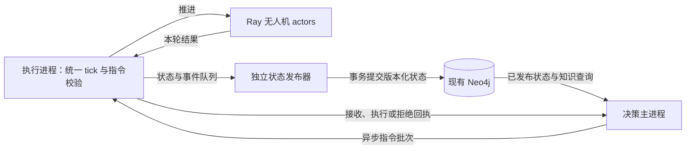

# Neo4j 状态读取与异步决策可行性评估

分析日期：2026-10-27。本文是方案评估，未修改仿真和数据库实现。

### 任务背景

用户提出：让主进程从现有 Neo4j 查询无人机状态，替换当前向全部 Ray actor 拉取状态的方式；提高主进程的决策响应能力，并让决策和无人机执行尽量并行，减少同步等待。

默认先保留统一仿真时钟和现有业务规则，再评估如何拆分执行、状态发布和决策。本文对现有能力的判断来自当前写入器、调度代码及仓库中记录的既有图 schema 合约，没有连接某个 Neo4j 实例逐字段核验。

### 关键结论

- 思路现实，Neo4j 可以充当已发布状态与知识上下文的共享来源；真正减少等待的关键是执行和决策解耦，数据库替换本身不会自动实现并行。
- 当前图谱已经保存位置、电量、负载计数、任务属性、任务归属及历史快照，支持基本候选筛选；但不能原样重建当前 Ray 返回的全部调度与执行状态。
- 当前数据库写入由主进程在等待 Ray 结果后执行。只改 `_sync_drones()` 为 Cypher，会读到上次落库的状态，原有 `step()` 全局等待仍然存在。
- 需要补充状态版本、发布时间、队列顺序、执行目标与命令确认协议，并将状态写入从决策主循环拆出。
- 推荐第一版采用“执行进程 + 独立状态发布器 + 决策进程”，保留统一 tick；主进程读已提交快照，在下一轮执行期间计算面向后续边界的决策。
- 完全取消所有 actor 的步同步、让每架无人机自主推进，是进一步的运行语义改造，涉及不同 Agent 的逻辑时间、交接因果关系、实验可重复性及恢复协议。
- 主进程需要资源保障，但提高 CPU 优先级不能消除数据库、模型推理和过期状态问题，也不能用 Ray 的 `num_cpus` 代替操作系统 CPU 隔离。
- 尚无新方案的并发读写实测，因此不能承诺它比直接 Ray 通信更快。必须同时评估决策耗时、状态年龄、指令生效延迟和业务结果。

### 一、为什么不能只替换状态读取函数

当前实际依赖链为：

```text
主进程发出 actor.step()
  → ray.get() 等待所有 actor
  → 主进程汇总状态和事件
  → 主进程 record_step() 写入 Neo4j
  → 下一轮同步、决策与派单
```

因此当前数据库并没有独立于主进程持续接收新状态。若只把 `_sync_drones()` 改成查 Neo4j：

1. 数据库主要提供上次提交的状态；
2. 本轮仍然必须有人驱动 actor 并接收结果；
3. `step_once()` 内对所有 actor 的等待没有消失；
4. 还增加了数据库查询、结果转换和状态重建开销。

要实现用户要求，必须把“谁推进无人机”和“谁计算全局任务分配”拆开，并由执行端持续发布状态。主进程可以不再等待全部 actor 的实时查询响应，但读取的是明确版本的已发布状态。

源码依据：`simulation/ray_delivery_sim.py:456`、`:468`、`:519`；`simulation/knowledge.py:498`。

### 二、现有图谱能支持到什么程度

| 决策需要的信息 | 现有存储 | 评估 |
|---|---|---|
| 无人机 ID、区域、位置、状态 | Drone / AgentState | 已有，需核对新鲜度 |
| 剩余电量、累计里程 | Drone / AgentState | 已有，AgentState 需启用记录 |
| 队列长度、载货数量 | Drone / AgentState | 足够做计数筛选，不能替代完整任务列表 |
| 速度、队列/载货容量、电量参数 | Drone 属性 | 当前写入器支持；可一次加载并缓存静态能力 |
| 任务位置、释放/截止时间、分配与取货状态 | Task 属性 | 已有，但业务事件驱动更新，未必包含所有未触发写入的任务 |
| 当前任务与 Agent 的关联 | ASSIGNED、CARRYING 等关系及 Task 归属属性 | 可辅助重建，需处理历史关系和 active 标记 |
| 队列的精确顺序 | 当前 AgentState 只有 queue_len | 缺少显式顺序；需要扩展 |
| 当前移动目标、阶段、已锁定的充电 depot | Ray snapshot 中有 target、target_depot 等 | 当前 AgentState 未保存这些字段 |
| 故障、互助标记 | 新写入器支持部分字段 | 既有观测图合约未保证包含，应逐 run 核验 |
| 状态是否最新、属于哪个发布批次 | AgentState 有 step_index / time_minute；Drone 有事件 updated_at | 不足以构成异步发布协议 |
| 重启后顺序、乱序写入识别 | 没有运行代次与状态序号协议 | 需补充 epoch / seq 或等价机制 |
| 决策提交、任务预留、接单确认与重复指令识别 | 现有 assign 返回 accepted | 需建立跨进程、可重试的指令协议 |

`Drone.updated_at` 当前取业务事件的仿真时间，不是墙钟更新时间。启用 AgentState 后，`record_step()` 会更新 Drone 的部分属性，但没有同时更新这个 updated_at。因此不能直接把它当作实时心跳。

开启 AgentState 时，一步的 Step 和该批 AgentState 已通过同一条 `UNWIND` 写入，这是构建发布批次的可用基础。不过当前 Task 和关系更新仍有独立语句，不能把整个数据库视为同一个 tick 的完整状态。

项目已有 `bootstrap_headless_checkpoint.py` 从图恢复任务与无人机的逻辑，说明基本状态可重建；它需要静态场景、关系和计数校验，队列顺序按派单时间等规则重建，并不是高频读取的无损快照接口。

结论：可以保留现有 Run、Drone、Task、Event、Step、AgentState 结构，增加决策所需的状态载荷和发布协议；没有必要推翻现有图谱。当前数据足以做简单筛选，复杂互助和完整替换需要补充。

源码依据：`simulation/knowledge.py:572`、`:604`、`:636`，`simulation/ray_delivery_sim.py:260`、`:309`，`scripts/bootstrap_headless_checkpoint.py:62`、`:146`。

### 三、推荐第一版：决策与执行分进程，保留统一仿真时间



各部分职责：

- **执行进程**：保留 Ray actor、仿真时钟和局部执行规则；消化指令，在明确边界生效，推进当前队列，不等待全局策略每次计算结束。
- **状态发布器**：从执行侧收取状态与事件，按版本顺序批量写图；数据库写入不再占用决策主循环。第一版可使用一个发布器，减少旧事件覆盖新状态及多写者冲突。
- **决策主进程**：查询已经发布的快照，批量筛选候选，计算策略，发送指令并跟踪回执。它不需要直接拉取全部 actor 的 snapshot。

这一版不要求每个 actor 各自维护数据库连接，也不要求增加 Kafka 或 Redis。可以先用内部异步队列或轻量消息接口连接组件；具体传输方式在实现阶段确定。

时序示例：

```text
Neo4j 已发布第 k 步状态。
执行进程开始推进第 k+1 步。
决策进程同时读取第 k 步并计算新分配。
新分配带 apply_at_step，在后续可接受边界校验并生效。
执行进程继续按规则推进，状态发布器独立提交新状态。
```

决策不能倒灌进已经执行的 tick。若计算错过目标生效边界，需要明确延期、重算或过期拒绝；主进程优先级高也不能省略这条规则。

这一方案让主进程的决策与 actor 执行重叠，但执行进程内部仍可保留“本轮所有 actor 完成后推进统一时间”的同步方式。它减少决策侧等待，不宣称消除所有同步屏障。

### 四、状态发布与查询协议需要补什么

#### 4.1 分清执行状态与已发布状态

actor / 执行进程维护实际执行状态；Neo4j 保存可供外部读取的已发布视图。决策时允许有界滞后，执行端根据最新实际状态确认指令。

建议在发布元数据中明确：

```text
run_id                 实验身份
runtime_epoch          启动/恢复代次
snapshot_id 或 seq     发布批次/顺序
step_index / sim_time  仿真逻辑时间
produced_at            状态产生时间
published_at           提交发布的时间
schema_version         状态载荷版本
```

墙钟时间用于评估延迟和新鲜度，仿真时间用于任务时效计算，二者不能混用。跨机器估计产生到接收的延迟时，还需考虑时钟对齐。

初始化时要发布所有无人机及必要的任务数据；没有写入图的任务或无人机不能被解释为“不存在”。静态能力、depot 表和任务几何信息可缓存，避免每轮重复查询。

#### 4.2 先复用 AgentState，增加完整决策载荷

第一版可扩展每步 AgentState，记录有序队列 ID、在手任务 ID、当前目标/阶段及目标 depot，并提供重建调度视图所需的相关任务数据。

无需逐字复制全部 DroneAgent：应定义供策略使用的 `SchedulingView`，让简单策略直接使用 queue_len 等计数；只有需要精确预计路线的策略才读取有序任务详情。静态字段可以由缓存补齐。

若要求任务和 Agent 严格来自同一版本，相关任务状态也应版本化，或随决策快照保存必要载荷。不能将旧 AgentState 与随时变化的 Task 当前属性任意拼接后宣称时间一致。

#### 4.3 发布完成标记与索引

建议将一批完整快照与发布指针在一次显式事务中提交，例如 `Run.published_snapshot_id` 指向已完成批次，读者只消费该版本。若批次需要分多笔写入，必须在全部写入并校验完整后才发布完成标记。

读者先取得已发布版本，再按版本查询不可变快照，避免每次在百万历史状态中计算“每架无人机最新一条”。版本还需要绑定对应的任务状态，才足以支持完整一致视图。

当前 `(run_id, step_index)` 等 AgentState 索引可作为第一版基础；新版本键与查询条件变化后，应补充并验证相应索引。后续若采用逐 Agent 自主发布，可新增每架一条的 DroneRuntimeState 最新视图，并继续保留 AgentState 历史。

Neo4j 默认采用 read-committed；并发查询不能自动代表同一逻辑时刻的全局快照。发布版本和并发写入协议必须由应用明确设计。[Neo4j 并发访问说明](https://neo4j.com/docs/operations-manual/current/database-internals/concurrent-data-access/)

### 五、异步指令不能省略执行确认

读取数据库替代的是状态拉取，指令仍可经 Ray 下发。主进程可以异步批量提交并稍后收取回执，减少逐任务阻塞，但不能在指令发出时就视为已经接单。

建议的指令信息：

```text
command_id
run_id / runtime_epoch
task_id / drone_id
based_on_snapshot_id
expected_task_version
apply_at_step 或有效期
action / reason
```

执行侧校验最新的任务归属、无人机状态、容量、电量和必要的时效条件，返回已应用、已拒绝或已过期。主进程维护待确认指令，避免图谱尚未刷新时反复分派同一任务。

任务预留与归属修改要有统一写入者或明确的事务/锁协议。简单先查“任务未分配”再单独写入，不能处理多个并发请求竞争；仅有一个版本字段也不等于已经实现正确的条件提交。

重试需要使用相同 command_id 并检查既有结果。没有收到回执不代表指令没有执行，不能凭超时直接当作未生效并换一架无人机。

当前电量准入被注释的问题也必须纳入实验语义：若希望执行端严格检查电量，需要明确恢复硬约束；不能在异步改造中未经说明就改变这项行为。

### 六、主进程优先级与低延迟的具体含义

优先保障建议落在以下位置：

- 独立进程运行决策，预留 CPU 和内存；需要隔离时采用操作系统或容器资源配置。
- 为 Neo4j 和状态发布器保留资源，避免主进程算得快而新状态迟迟无法提交。
- 决策查询使用独立连接预算、明确数据库、参数化查询和超时；大规模压测、导出与历史分析不要占满在线决策资源。
- 一次或少数几次查询批量取得所需候选，不对所有无人机重复运行全部 56 个上下文查询。
- 将日志、页面渲染、大量历史写入从决策关键路径拆出；LLM 决策需要时间预算和可用的规则策略，不能仅靠 CPU 优先级解决远程推理耗时。

Ray 的 CPU 资源是逻辑调度资源，不会自动绑定或独占物理 CPU；当前 `num_cpus=1` 不能作为主进程高优先级或 CPU 隔离保证。[Ray 资源说明](https://docs.ray.io/en/latest/ray-core/scheduling/resources.html)

查询本身也有事务与往返成本。复用连接、明确目标数据库、批量操作应结合一致性需求设计，而不是单纯增加并发。[Neo4j Driver 性能建议](https://neo4j.com/docs/python-manual/current/performance/)

### 七、如果进一步要求每架无人机独立运行

可以进一步让 actor 独立小步推进和发布，主进程读取各自最新有效状态，无需所有无人机齐步完成；但这时各 Agent 可能位于不同逻辑时间。

需要新增或重新定义：

- 共享时钟、最大时间偏差、任务释放和指令生效语义；
- 交接双方的位置与时间确认，避免将异时状态直接计算为一次可行交接；
- 每架 Agent 的版本、心跳、过期与恢复代次；
- 全局 Step、检查点和故障重放的含义；
- 与原同步实验的可比性和确定性要求。

普通同步 actor 内不能简单增加一个永不返回的 run 循环，然后期望其他控制方法及时执行。应采用有限小步和指令队列，或支持让出执行的异步设计，并保持状态修改顺序。[Ray actor 并发说明](https://docs.ray.io/en/latest/ray-core/actors/async_api.html)

第一版建议先实现决策与执行流水线，再按性能证据决定是否取消执行侧全局同步；这能分别评估收益与语义变化。

### 八、性能判断与验证顺序

原方案主要成本包括全量快照同步、策略、逐任务确认、整批执行等待和记录。新方案增加状态发布、数据库提交、查询与指令排队，收益来自它们能够和执行重叠、读取已发布状态不必重新等待全部 actor。

必须分别记录：

| 指标 | 作用 |
|---|---|
| 状态从产生到发布的 p50/p95/p99 | 判断发布是否跟得上执行 |
| 查询时状态年龄、不同 Agent 的时间偏差 | 判断主进程决策依据是否有效 |
| 数据库查询与状态转换耗时 | 判断替换读取来源的真实成本 |
| 策略或模型耗时 | 判断决策预算是否达标 |
| 指令发送到应用的延迟 | 判断决策何时真正影响执行 |
| 过期、拒绝、重复与重试数 | 判断异步控制是否稳定 |
| 业务完成率、迟到率、互助行为 | 防止用旧状态换取表面低延迟 |
| 执行吞吐、发布队列积压与资源使用 | 判断系统能否持续运行 |

所有指标需要与同一数据、参数、规则及规定的仿真时钟下的基线对比。不能只比较一条 Cypher 和一次 snapshot 的耗时，也不能把并行后的流水线周期当成单次指令的端到端延迟。

容量估算：状态更新量约为无人机数量乘以发布频率。例如 100 架、每秒发布 5 次，产生 500 条 Agent 状态更新/秒；若每次都追加历史，1 小时为 180 万条 AgentState，另有关系和索引开销。这只是算术例子，不是推荐频率或实测能力。最新视图发布与历史采样频率可以分开设计。

状态队列需有容量和重试策略；可合并的最新状态与不可随意丢失的任务事件应区分。持久化长期跟不上时，无法同时无限运行、无限保留全部历史且不积压，必须定义采样、背压或恢复边界。

### 执行过的操作

- 核对 `simulation/ray_delivery_sim.py` 的快照字段、代理重建、主循环、状态获取和指令确认。
- 核对 `simulation/knowledge.py` 的 Drone/Task 写入、AgentState 字段、Step 批量写入与索引定义。
- 核对 `simulation/delivery_sim.py` 和 `planner.py` 的成本与互助计算需要哪些状态。
- 阅读 `scripts/lade_llm_context_templates.py` 中既有实验图的保守 schema 合约。
- 阅读 `scripts/bootstrap_headless_checkpoint.py` 的数据库重建路径，及现有检查点和页面入口的同步假设。
- 使用 `PYTHONDONTWRITEBYTECODE=1 ./run_in_lade.sh python -` 做 AST 字段清单比较：Ray snapshot 包含 queue_payload、target、target_depot 等；AgentState 未包含队列顺序、目标与墙钟发布字段。
- 核查 Neo4j 与 Ray 官方文档的并发、资源与查询性能边界，来源已在对应段落链接。
- 未连接真实 Neo4j、运行压测、修改 schema、调整进程优先级或启动实验。

### 修改内容

仅新增 `docs/codex_notes/10/27-Neo4j状态读取与异步决策可行性评估.md`。文中的新字段、组件和协议都是建议，尚未实现。

### 后续建议

1. 先对拟使用的数据库和 run 做只读字段、新鲜度、索引及数据完整性核验。
2. 明确允许的状态滞后、指令生效边界、是否保留统一时钟，以及电量准入规则。
3. 首版保留 Ray 执行和统一 tick，拆出状态发布与决策进程；增加版本化快照、指令 ID、待确认队列和执行前校验。
4. 使用隔离的新 run 验证查询正确性、并行重叠、指令幂等、过期拒绝与失败恢复，并对比同步基线。
5. 达到稳定状态后，再按测量结果评估最新状态视图、发布采样或逐 Agent 自主执行。

本次无需用户确认；现有业务、实验与数据库均未改动。实现前应将上述语义选择写入具体设计，而不是直接替换一个状态读取函数。
