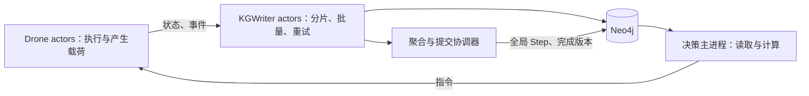

# Ray 各进程分担图谱写入评估

### 任务背景

用户提出将知识图谱写入下放到各个 Ray 无人机进程，减少主进程统一写入的工作。本次评估该方向在现有代码中的适用范围、并发和恢复影响，默认不修改实现、不启动实验或变更数据库。

### 关键结论

- 可以让 Ray 侧承担知识写入，执行状态产生者直接发布自己的状态和局部事件，有利于缩短主进程关键路径。
- 写入下放与异步运行是两个不同改动。如果 actor 在 `step()` 返回前同步落库，主进程依然等待各 actor 完成执行和写入；是否加速需要测量。
- 无人机状态适合按 drone_id 划分写入者；全局 Step、任务归属和跨机交接需要各自明确的唯一提交职责，不应让所有 actor 都更新全部图对象。
- 现有 `_write_event()` 同时修改 Run、Region、Drone、Task 和关系，`record_step()` 又依赖全局任务与全部 Agent，不能直接为每个 actor 各复制一份并按原方法调用。
- 每个进程直接连接数据库可以做初版；规模上升时，建议评估独立的 KGWriter actor 池，按键有序处理、批量提交并控制数据库并发，主进程同样无需执行这些写入。
- 需要统一 run_id、写入版本和事件 ID，防止重复、乱序和故障恢复期间的旧写入覆盖新状态。
- 当前 headless 恢复假定集中写入时序。改为 actor 独立落库后，必须区分各 actor 已写入和全局已提交，否则部分成功会破坏恢复判断。
- 本次只完成代码和官方文档核对，没有实际验证多进程写入吞吐，也不保证写入进程越多性能越高。

### 一、哪些写入可以分散

| 数据 | 建议负责者 | 原因 |
|---|---|---|
| 单机位置、电量、运行状态、累计里程 | 对应 Drone actor，或按 drone_id 分片的写入 actor | 数据来源与更新顺序清楚 |
| 单机 AgentState 历史快照 | 同上 | 可按 run、Agent、版本区分 |
| 取货、完成、低电、返航、充电等事实事件 | 执行 actor 产生，独立写入通道提交 | 可以采用稳定事件 ID 与版本重试 |
| Task 当前状态与归属 | 明确的任务提交者；或有效所有者按任务版本提交 | 旧 actor 的延迟更新不能覆盖新执行者 |
| 跨机重派、交接、接管关系 | 协调提交者 | 涉及两架无人机和同一任务，需保持逻辑一致性 |
| 全局 Step 汇总与完成标记 | 聚合器 | 需要汇总所有相关 actor，不能由单架无人机代表全局 |
| Run、Region、静态能力、索引与约束初始化 | 初始化组件 | 减少重复建图、公共节点争用和启动检查 |

这些负责者可以全部位于独立进程或 Ray 服务中；不要求决策主进程保留数据库写入。

重要区别：actor 可以报告“我已取货/完成”的事实，但它对 Task 当前归属的修改必须经过所有权和版本校验。事实事件入库与当前实体投影更新可以拆开。

### 二、直接搬入 actor.step() 会发生什么

当前结构为：

```text
各 actor 并行执行 step
  → 主进程 ray.get 等全部返回
  → 主进程逐项写事件
  → 主进程写全局 Step 与 AgentState 批次
```

若简单改为：

```text
每个 actor 执行 step
  → 该 actor 同步写 Neo4j
  → 返回结果
主进程 ray.get 等待全部返回
```

那么局部事件写入可能并发，但主进程的等待仍然覆盖各 actor 的计算与数据库提交。某个 actor 写入慢会拖长本轮；当前一次 `UNWIND` 批量写所有 AgentState 的方式，也可能被拆成更多小事务。

因此同步下放适合验证职责拆分与并发吞吐，不代表已经达到主进程决策和无人机执行并行的目标。现有三次 `_sync_drones()` 和整批 `step()` 等待也不会因写入迁移而自动消失。

源码：`simulation/ray_delivery_sim.py:251`、`:468`、`:519`；`simulation/knowledge.py:498`。

### 三、两种可选落地方式

#### 3.1 每个 Drone actor 独立写入

每个 actor 在进程内创建自己的数据库连接，提交本机状态与事件。实现路径比较直接，但需要控制每个进程的连接池、事务次数和重试，避免数据库被大量小事务或连接淹没。

若将写入放在后台线程或独立协程中，必须先在执行方法中冻结本次状态与事件载荷，再交给写入队列；后台写入器不能一边遍历可变队列、一边让 step 修改同一对象。

后台处理并不意味着可以忽略提交结果：需要可观察的积压、失败与重试状态。actor 退出或被 `ray.kill()` 时，尚未提交的内存队列可能丢失；关键事件需要持久待发送记录或可验证的重放来源。

每个进程应创建自己的 Driver，不把主进程已创建的 Driver 序列化传入 actor；进程内并发任务也要各自使用 Session。[Driver 进程边界](https://neo4j.com/docs/api/python-driver/current/api.html)、[Session 使用规则](https://neo4j.com/docs/python-manual/current/transactions/)

#### 3.2 Ray 侧专门设置 KGWriter actor 池



写入池可以按 drone_id 路由本机状态，确保同一 Agent 的状态有序处理；任务归属则路由到明确的任务提交职责，不能仅依靠不同 drone 的写入顺序。

这一方式增加一次消息转发，但便于控制数据库连接、聚合多条状态、处理重试和隔离数据库延迟。写入池的大小应按数据库吞吐和延迟测量确定，不应直接等于无人机数量。

若只创建一个写入 actor、每次接到请求立即同步执行一条语句，没有批量和队列管理，也可能只是把原有串行瓶颈换了位置。目标是把写入从决策路径拆出，并管理吞吐，而不是只换进程名称。

两种方式都能让主进程不负责具体落库。针对当前集中写入实现，建议先独立出可复用的“状态/事件载荷 → 写入事务”接口，再比较直接写入和受控写入池。

### 四、现有写入器需要调整的具体点

#### 4.1 固定运行身份

当前 `Neo4jKnowledgeStore` 未传 run_id 时会自动生成 UUID。若各 actor 各建存储却没有显式传同一个 run_id，会把一次实验拆成多个 run。

初始化组件应分配并传入一致的 run_id、配置和恢复代次。索引检查、创建与等待也由初始化组件执行，避免每个 actor 重复运行启动流程。

源码：`simulation/knowledge.py:235`、`:250`、`:269`。

#### 4.2 拆分公共实体与本机更新

当前 `_write_event()` 同时执行：

```text
MERGE/SET Run
MERGE/SET Region
MERGE/SET Drone
MERGE/SET Task
MERGE Event 与相关关系
```

将它原样放入所有 actor，会让看似独立的无人机写入同时修改公共节点，增加锁竞争概率。尤其 Task 归属变化后，原 actor 的延迟事件仍可能携带旧 Task 属性。

应把静态初始化、单机状态、事实事件、Task 投影及交接关系拆成职责明确的写入路径，缩短事务并避免无必要的公共属性重写。

源码：`simulation/knowledge.py:591`、`:671`、`:706`；互助关系见 `:402`。

#### 4.3 唯一约束、稳定事件和写入顺序

现有事件 ID 已按 run、事件类型、时间、无人机和任务构造，具有重放复用基础。多写者方案还需要核对实际数据库中的唯一约束，而不能仅依靠 `MERGE` 来保证并发创建唯一。[Neo4j MERGE 与约束](https://neo4j.com/docs/cypher-manual/current/clauses/merge/)

建议在最终版本模型下明确：

- Drone、Task、Region 的运行内唯一身份；
- Event 的稳定逻辑 ID，不因一次超时重试就换新 ID；
- AgentState 的 run、Agent、恢复代次与状态顺序；
- 同一 Agent 最新状态只接受有效代次中更新的序号；
- 任务当前状态只由有效所有者或统一提交者按任务版本修改。

代次与事件 ID 的职责不同：恢复代次可用于拒绝旧进程继续发布，逻辑事件 ID 用于识别重试；不能简单在每次重启后生成一批全新事件并称为幂等。

### 五、全局 Step 和恢复不能让所有 actor 各写一遍

当前 `record_step()` 计算全局未完成任务数、各状态 Agent 数和总里程，并使用 `SET s = $step`。如果每个 actor 都以自己的局部数据写同一个 Step，会互相覆盖，结果也不再具有全局含义。

应让各 actor 只报告本机状态/事件已提交的版本，再由聚合器：

1. 检查该发布批次需要的 actor 是否完整；
2. 汇总全局指标；
3. 按恢复要求确认检查点与持久化位置；
4. 标记 Step 或发布批次已完成，供需要一致快照的查询读取。

`max(step_index)` 不等于“所有 actor 都已写完该步”。主进程如果允许不同 Agent 的最新状态参与决策，可按每架状态版本与年龄读取；如果要求同一全局步，则要消费聚合器确认完成的版本。这是两种不同的一致性要求。

特别是故障恢复：某些 actor 可能已经把第 k+1 步写入数据库，另一些却在本轮失败；主进程可能仍只有第 k 步检查点。旧的恢复判断只比较全局 Step 与检查点，无法单独解决这种部分成功。

必须区分“各 actor 已落库”与“全局已提交”，并定义重放、过期代次过滤和当前状态投影的恢复方式。当前公开 Task/Drone 属性不能被未提交的未来状态直接覆盖后仍当成已提交版本读取。

源码：`simulation/knowledge.py:125`、`:498`；`scripts/run_headless_sim.py:99`、`:201`、`:316`。

### 六、主进程还会保留哪些工作

写入下放后，主进程可以专注于图查询、策略和指令，但现有应用仍依赖：

- `env.tasks` 和代理状态的更新；
- 页面指标、frame、KG 最近事件的展示；
- 检查点和全局完成判定；
- 派单与互助回执。

这些都要有明确的数据来源，不能删掉原有返回结果后期望自动继续工作。特别是页面使用主进程 `knowledge_store.events`，actor 内的内存事件列表不会自动共享给它；可以传递有限事件摘要或改为独立查询。

写入职责迁移也不等于读取来源已经替换。若仍保留原 `_sync_drones()` 与 `ray.get(所有 step)`，主进程依然按旧方式读取和等待。要达到此前提出的目标，需要继续拆分执行与决策循环，并定义已发布状态和指令生效边界。

### 执行过的操作

- 阅读当前 actor 的 assign、step、交接方法及主进程事件写入路径。
- 核对 Neo4j 存储构造、事件 ID、公共实体更新、互助关系和全局 Step 写入。
- 核对 headless 的检查点钩子、Ray 故障重试和数据库位置比较。
- 查询 Neo4j 官方 Driver、Session、MERGE 文档，确认进程连接边界与并发唯一性要求。
- 使用 `nl -ba`、`sed -n` 进行只读代码检查；没有运行真实数据库写入、性能压测或新测试。

### 修改内容

仅新增 `docs/codex_notes/10/27-Ray各进程分担图谱写入评估.md`。本文中的写入分工、队列、约束与恢复协议均为建议，未改代码、数据库或实验。

### 后续建议

1. 先拆分本机状态、事实事件、任务归属和全局 Step 四类写入接口，明确更新者。
2. 在隔离的新 run 中验证少量 actor 直接发布，检查字段、版本、事件去重、交接和局部失败。
3. 对比直接写入与 KGWriter 池，记录执行耗时、落库延迟、状态年龄、连接数、事务数量、锁等待和写入积压。
4. 若需要持续异步执行，再增加可靠的待发送记录、受控重试、发布完成标记与恢复协议。
5. 最后将决策读取切换到已发布图状态，并验证主进程与执行循环确实重叠。

本次无需用户确认。实际实施时应使用独立实验 run，并保持同步基线可复现。
