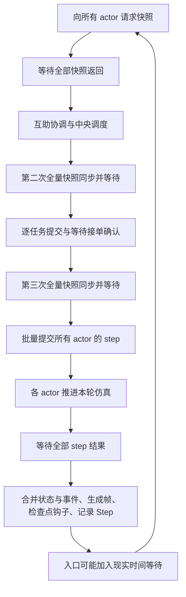

# Ray 状态获取与任务执行的同步机制

### 任务背景

用户希望确认主进程获取 Ray 无人机状态是否耗时、获取与执行是否重叠，以及是否必须等待所有 actor 返回后才能继续。本次沿当前代码顺序核对，并读取本机已安装 Ray 的 API 说明；不修改业务代码、不启动集群。

### 关键结论

- 获取状态有实际开销，包括远程方法调度、快照构造、序列化、结果传递以及主进程代理对象重建；本次没有测量这些阶段的具体耗时。
- `_sync_drones()` 批量提交所有 actor 的快照请求，然后对整个引用列表调用 `ray.get()`。不同 actor 可并行响应，主进程必须取得该批所有结果才能进入后续业务代码。
- `step_once()` 先完成状态同步与派单，再批量提交各 actor 的 `step()`。它也等待整批执行结果，然后才合并事件、更新状态、写入知识存储并结束当前一步。
- 当前没有把本轮状态同步、中央决策和执行下一步组织成重叠流水线。actor 由主进程调用 `step()` 推进，在主进程决策、落库等阶段，不会自行持续推进仿真。
- 正常每轮 `release_and_assign()` 有 3 次全量 `_sync_drones()`；任务提交采用循环内单次 `ray.get(actor.assign.remote(...))`，逐任务等待确认。
- 等待的是一轮快照或一个时间步的计算结果，不是等待所有配送任务完成。仿真 `step_seconds` 与实际计算、通信耗时是不同概念。

### 一、获取状态是怎样并行、怎样等待的

实际代码：

```python
snapshots = self.ray.get([
    actor.snapshot.remote()
    for actor in self.actors.values()
])
self.drones = [
    proxy_from_snapshot(snapshot, self.planner)
    for snapshot in snapshots
]
```

列表推导会依次发出远程请求，并收集结果引用；请求提交后，不同 actor 的快照方法可以并发执行。接着主进程进入 `ray.get(引用列表)`，等待全部结果可获取，再重建代理对象并继续。

这与逐个“发一个快照请求、等它返回、再发下一个”不同：当前快照请求是先形成一批，统一等待。但它也没有“先到一部分，就先拿这部分进行下一轮派单”的业务处理路径。

源码：`simulation/ray_delivery_sim.py:456`。

### 二、状态获取和执行阶段的先后关系



各 actor 的本轮 `step()` 可以并行；主进程在这期间阻塞等待结果。它不会同时拿一部分结果提前计算下一轮，代码中也没有针对这些方法配置异步 actor 或额外的后台仿真推进循环。

一个 actor 先完成本轮后，主进程仍要等待其他 actor。正常情况下，它的下一步也要等主进程结束汇总并发出下一轮调用。

源码：`simulation/ray_delivery_sim.py:251`、`:468`、`:519`。

### 三、主进程有哪些等待点

| 位置 | 等待内容 | 对后续流程的影响 |
|---|---|---|
| `_sync_drones()` | 全部 actor 快照 | 取得整批后再继续 |
| `step_once()` 的列表 `ray.get()` | 全部 actor 的本步结果 | 全部返回后才开始结果合并 |
| `_assign_task_with_retry()` | 单个 actor 的接单响应 | 当前任务处理完才处理循环中的下一任务 |
| 互助转移 | 原 actor 释放、援助 actor 接单，必要时恢复 | 按依赖顺序等待 |
| 中央结果处理 | 事件记录、检查点钩子、Step 写入等 | 这些调用结束后才返回本步 |

`release_and_assign()` 中三次全量同步分别位于：进入互助与调度前、生成初步分配后、提交实际分配后。源码位置为 `simulation/ray_delivery_sim.py:520`、`:529`、`:536`。

逐任务确认见 `simulation/ray_delivery_sim.py:664`；互助中的顺序等待见 `:594`、`:610`、`:616`。当前主流程没有使用 `ray.wait()` 逐个消费先完成的 actor 结果。

### 四、时间开销应怎样理解

当资源足够、多个 actor 确实并行执行时，单个批次的等待会受最慢结果影响，而不是简单把所有 actor 的计算时间相加；但仍需考虑请求提交、调度排队、数据搬运与本地转换成本。

例如三个 actor 的本轮执行分别花 10、20、50 毫秒，则整批执行阶段至少要等到最慢的约 50 毫秒结果，另加相关开销。这只是说明机制的假设例子，不是本项目实测数据。

一轮的耗时可按以下结构拆分：

```text
三次快照批次的耗时之和
+ 互助与中央策略耗时
+ 各任务顺序接单确认及相应记录耗时
+ 整批 actor step 的等待耗时
+ 结果合并、展示帧、检查点与知识写入耗时
+ 入口设置的 wall_interval 等现实等待
```

仿真时间步例如为 6 秒，表示一次 `step()` 按 6 秒的业务时间计算移动，不表示必须用现实 6 秒运行。实际用时取决于代码计算量、数据传输、资源、模型与数据库调用，以及入口设置的节奏。

### 执行过的操作

- 使用 `nl -ba`、`sed -n` 核对 `simulation/ray_delivery_sim.py` 的 actor 方法、快照同步、主循环、任务提交与互助转移。
- 使用 `rg -n` 检查 `ray.get`、`ray.wait`、远程调用、异步方法与并发配置，以及 headless 检查点钩子。
- 通过 `PYTHONDONTWRITEBYTECODE=1 ./run_in_lade.sh python -` 导入本机 Ray，读取版本及 `ray.get` docstring。版本为 `2.55.1`，本机文档明确其阻塞等待行为。
- 未运行真实 Ray 集群、性能压测或新测试；本次未宣称具体通信延迟或并行加速比。

### 修改内容

仅新增 `docs/codex_notes/10/27-Ray状态获取与任务执行同步机制.md`，没有修改仿真、调度或运行参数。

### 后续建议

若后续需要优化，先分别记录三次快照同步、逐任务确认、整批 step、结果合并及落库的耗时，确认真正瓶颈。再评估复用已有 step 返回快照、合并请求或引入分批结果处理；改变同步边界前，需要明确策略是否允许不同时间的状态参与同次决策。本次不实施这些改造，无需用户确认。
