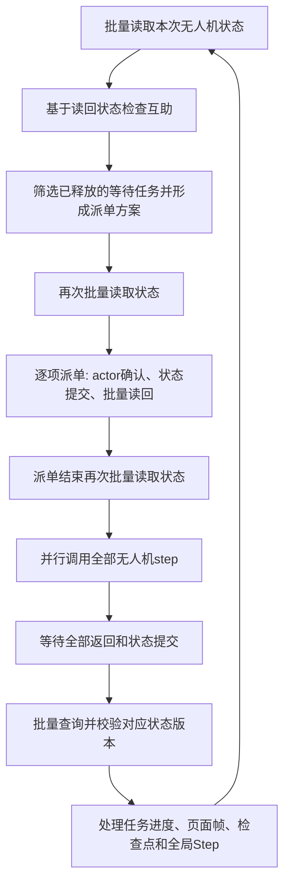

### 任务背景

用户希望了解当前主进程怎样查询知识图谱、何时读取、怎样使用结果进行决策，以及是否还需要等待 Ray。以下根据当前工作区代码核查，说明的是启用 `KG_STATE_SOURCE=neo4j` 后的逻辑，不代表已检查运行中的服务是否加载了新代码。

### 关键结论

- 主进程通过自己的 Neo4j reader 连接，按 `run_id + execution_id + 本次无人机 ID 列表` 批量读取 `DroneRuntimeState`；不通过普通 Drone/AgentState 的“最新时间”猜测本次有效状态。
- 每个节点返回版本、协议版本和完整状态 JSON。主进程校验每架无人机的预期操作版本，拒绝缺失、重复、损坏或版本不符的数据，不自动回退到 Ray。
- 读取结果转换为主进程内存中的 `DroneStateProxy` 和任务更新缓存。调度算法用这些内存对象规划；数据库提供当前状态，不在 Cypher 中直接完成任务规划，也没有接入 i 系列查询集合。
- 初始化、每轮派单的几个同步点、每次派单或互助操作后、每轮执行完成后都会读取。按当前结构，即使没有新派单和互助，一轮也有 4 次完整无人机状态批量查询；每次 actor 状态变更命令后再增加 1 次。
- Ray 无人机之间的 step 并行，但主进程仍等待本轮全部 actor 返回、状态提交及查询校验完成，之后才能推进下一轮。尚未实现主进程规划与无人机运行的异步流水线。
- `ray` 写入模式由 actor 提交状态后返回确认；`process` 写入模式由主进程转交状态给独立写入进程，确认提交后查询；`main` 模式由主进程自行提交后查询。
- 初始任务目录与未发布任务的 release 信息仍来自 CSV 和内存；派单、取货、完成等操作的任务更新使用图中读回的完整数据。若启用区域 LLM，还可能额外查询历史事件与近期表现，独立于本次运行状态查询。

### 执行过的操作

- 分段读取 `simulation/ray_delivery_sim.py`：初始化、`_initialize_graph_state`、`_call_actor`、`_sync_drones`、`release_and_assign`、`step_once`、任务进度应用及 actor 运行状态发布。
- 读取 `simulation/knowledge.py` 的 `publish_runtime_states` 和 `query_runtime_states`。
- 读取 `simulation/knowledge_writer.py` 的主进程 reader、写入队列排空及查询转发。
- 读取 `simulation/knowledge_state.py` 的 JSON 编码、完整性和版本校验。
- 读取 `simulation/delivery_sim.py` 与 `simulation/planner.py` 的调度入口和区域历史查询入口。
- 检查 `scripts/run_dynamic_sim.py` 的状态来源配置，以及 `git status --short`；使用 `rg` 定位代码与已有说明文件。
- 未启动仿真，未连接数据库，未修改运行代码；本次为代码逻辑说明，不重复运行测试。

### 修改内容

新增本说明文件。代码定位：

| 位置 | 作用 |
|---|---|
| `simulation/ray_delivery_sim.py:476` | 新建执行 ID、发布初始版本 0 状态 |
| `simulation/ray_delivery_sim.py:511` | actor 操作后等待写入、查询新状态 |
| `simulation/ray_delivery_sim.py:521` | 批量读图，重建代理和任务更新缓存 |
| `simulation/ray_delivery_sim.py:547` | 并行 step、全体等待、读图、处理结果 |
| `simulation/ray_delivery_sim.py:614` | 派单前后同步与互助协调 |
| `simulation/knowledge_writer.py:425` | 排空待提交写入，再由主进程 reader 查询 |
| `simulation/knowledge.py:324` | 实际 Neo4j 批量读取语句 |
| `simulation/knowledge_state.py:38` | 对查询结果执行版本与完整性检查 |

实际查询：

```cypher
UNWIND $drone_ids AS drone_id
MATCH (s:DroneRuntimeState {
  run_id: $run_id,
  execution_id: $execution_id,
  drone_id: drone_id
})
RETURN s.drone_id AS drone_id,
       s.execution_id AS execution_id,
       s.version AS version,
       s.schema_version AS schema_version,
       s.payload_json AS payload_json
```

这是一次请求里批量匹配所有本次无人机，使用相应复合唯一约束支持的索引；不是每架无人机单独发一个数据库查询。版本匹配在主进程收到结果后检查，各无人机的最近操作版本可以不同。

`payload_json` 中的 `snapshot` 包括位置、状态、电量、队列顺序与完整任务、载货任务、容量、目标、depot、故障、互助、累计距离和完成任务 ID；`task_updates` 保存此次状态发布包含的任务更新。主进程按全局操作序号保留每个任务已读到的较新更新，并在收到派单、取货、完成通知时将对应任务状态应用到全局任务目录。

一轮执行顺序：



互助中的释放、援助接单、失败回滚也是状态变更命令，各自确认并读回后再继续。若任意必需无人机状态缺失或不符合版本，当前代码报错，不以其他无人机的部分状态继续规划。

这里的“状态提交完成”针对主进程即将读取的运行状态视图；全局 Step 仍在本轮末尾按既有流程记录，不能理解为整个业务图谱已在一个跨 actor 的原子事务中提交。

### 后续建议

1. 性能分析时分别测量 actor 等待、状态提交、Neo4j 查询/解析、规划时间；目前不能仅凭改用数据库就认定等待减少。
2. 若要减少开销，优先评估合并无状态变更时的重复读取、批量派单后的统一刷新或按需刷新；修改前验证派单及互助一致性。
3. 若要真正异步调度，应另行定义允许的状态滞后和派单冲突校验，不能只删除当前的等待屏障。
