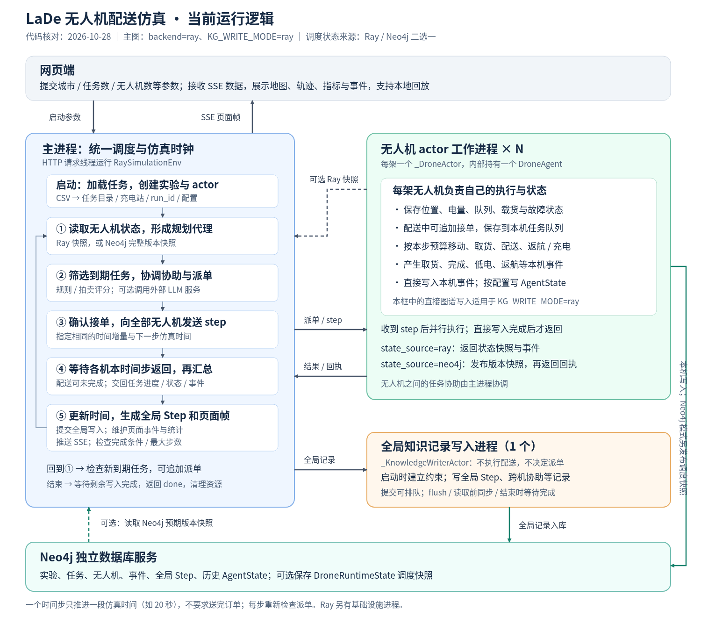

### 任务背景

用户希望用图说明当前项目的主进程、每架无人机及其他组件的职责，并解释仿真如何运行。本说明按 2026-10-28 工作区代码核对，不代表某个未检查的运行中进程一定加载了这些最新代码或参数。

### 关键结论

- 主图采用 Ray 仿真、`KG_WRITE_MODE=ray` 分担写入模式：主进程 + N 个无人机 actor + 1 个专用知识写入 actor + 独立 Neo4j 服务；Ray 本身另有基础设施进程。主进程内 HTTP 请求线程不属于额外的仿真进程。
- 主进程负责加载任务、维护待派任务目录和全局时钟、读取状态、统一派单、协调任务协助、等待全部无人机的本时间步调用返回、汇总结果和推送页面帧；不要求配送任务在本步完成。
- 每架无人机 actor 内持有一个 `DroneAgent`，维护自己的位置、电量、任务队列、载货与故障状态；执行移动、取送货、返航等行为并产生本机事件。当前每个无人机 actor 声明 1 个逻辑 CPU 配额，不代表绑定物理核心。
- `KG_WRITE_MODE=ray` 时，无人机直接写本机接单、取货、完成、低电等事件及状态；历史 `AgentState` 是否保存受配置控制。专用 `_KnowledgeWriterActor` 初始化约束，接收主进程的全局 Step、跨机协助和其他协调记录。主进程仍维护用于网页展示的事件列表。
- 调度状态有两条路径：`state_source=ray` 从 actor 获取快照；`state_source=neo4j` 在提交后读取 `DroneRuntimeState` 的完整快照，校验 execution_id、每架预期版本与完整性，再还原规划代理。主进程仍保留任务目录、配置和仿真时钟。
- 无人机在一个时间步内并行执行；主进程通过 `ray.get([...])` 等待全部返回。actor 直接写入属于本次调用的一部分，因此数据库提交慢也会延长该轮。当前不是无人机无约束地独立推进时钟。
- 写入位置、调度状态读取来源与是否启用 LLM 是独立配置；不能把“使用 Ray 仿真”等同于“必然由 actor 写图谱”或“必然从 Neo4j 读取状态”。启动脚本默认 `KG_WRITE_MODE=main`、`KG_STATE_SOURCE=ray`，主图明确展示另一种已实现的分担写入配置。
- 网页通过 SSE 接收数据和本地回放；当前新 `/events` 请求会替换旧仿真，不是单纯订阅同一后台会话。headless 入口复用仿真核心，改用循环、日志与检查点，不依赖网页连接。

[SVG 矢量原图](28-项目运行逻辑图.svg) · [PNG 图片](28-项目运行逻辑图.png)

读图：蓝色是主进程，绿色是每架无人机工作进程，橙色是专用写入 actor，底部是独立数据库。虚线是按状态来源选择的读取路径；主图中的本机直写适用于 `KG_WRITE_MODE=ray`。图中的 Step 是全局仿真步记录，AgentState 是按步保存的历史状态，DroneRuntimeState 是用于调度读回的版本化完整快照。

主进程内部的循环可按以下顺序阅读：

1. 启动时读取 CSV，按城市、日期、数量等配置构建任务、无人机、充电站、规划器、协调器及知识存储，创建 actor。使用 Neo4j 状态源时还要发布初始运行快照。
2. 每轮先取得当前无人机状态，处理故障、电量或时效触发的协助，再筛选已经到释放时间的待派任务。
3. 协调器通过规则/拍卖评分，或可选的区域 LLM 请求选择执行者；主进程调用目标 actor 接单，确认实际接受结果。LLM 请求由主进程协调器发起，不是每架无人机必然调用模型。
4. 主进程为全部 actor 发送同一时间增量和下一时刻。每架无人机根据自己的任务与剩余电量执行本步行为；在 Ray 写入模式下提交本机事件和状态，然后返回。
5. 主进程等待所有 actor 的本时间步调用返回，并非等待全部订单送达。Neo4j 状态源还要保证发布完成，读回并校验预期版本；随后同步任务完成与取货等进度、维护展示事件、更新仿真时间并生成帧。
6. 生成并提交全局 Step，通过 SSE 按 frame_stride 推送 frame；未完成则进入下一轮。所有任务完成或达到最大步数后，等待剩余委托写入，发送 done 并清理。

图中把派单和 step 归为“下发执行”以便阅读；实际每次接单、释放、恢复等远程调用也有各自的结果确认，在 Neo4j 状态源下会更新和读回对应版本。图中“读取状态”不表示一轮只有一次查询。

针对“等待返回”和“配送中新增任务”的补充：

- 一次 step 只推进指定时长的仿真时间。例如步长 20 秒，一次配送需要 3 分钟，则跨越多步完成；每步之间都再次进行调度。20 秒是模拟时长，不代表程序每次必须在现实中运行 20 秒。
- 例：10:00:00 派出 A；10:00:15 到达 B 的释放时间；10:00:20 首步汇总后，下一轮派单会检查 B，此时 A 可以仍在配送。B 可分给其他空闲无人机，也可能追加给仍在配送但能接单的无人机；没有合适候选时继续等待。当前模式没有在同一个远程 step 调用计算到一半时插入派单。
- `DroneAgent.can_accept()` 与 `DroneStateProxy.can_accept()` 不排除 delivering 状态；要求无故障、任务队列未满，且不处于 failed/charging/returning。`assign()` 追加任务队列。可接单不保证调度器一定选择该无人机，也不意味着立即丢下旧任务执行新任务。
- 上述新任务指本次启动时载入的任务到达 release_minute；当前 `/events` 启动/重启接口不是运行中追加外部订单的接口。
- 原图的“专用知识写入 actor × 1”表示每个 Ray 分担写入仿真环境有 1 个全局记录写入 actor，现改为“全局知识记录写入进程（1 个）”。它负责保存全局 Step、跨机协助等记录，不决定派单、不执行配送；各无人机在该模式下仍直接写本机事件与状态。

配置差异：

| 配置 | 无人机本机事件 / 状态写入者 | 全局记录写入者 | 主进程读取调度状态 |
|---|---|---|---|
| `backend=ray, kg_write_mode=main` | 主进程，根据 actor 返回结果记录 | 主进程 | 由 state_source 选择 |
| `backend=ray, kg_write_mode=ray` | 对应无人机 actor | 专用知识写入 actor | 由 state_source 选择 |
| `backend=ray, kg_write_mode=process` | 专用子进程，主进程转交 actor 结果 | 同一专用子进程 | 由 state_source 选择 |
| `backend=local` | 无人机行为在主进程内执行；写入可选 main/process | 按写入模式确定 | 主进程内存；不支持 Neo4j 调度状态源 |

`ray/process` 写入模式要求 Neo4j 后端。`main` 可用内存知识存储或 Neo4j；内存后端没有持久化数据库。选择 Neo4j 状态源时，主图的 Ray 写入模式由各无人机直接发布运行快照；其他写入模式则由主进程将状态转交对应写入通道。初始化快照及 schema 仍由初始化流程提交。

专用写入 actor 的命令可排队，但 `flush()`、跨机协助的同步点、读取前同步、结束等待都会形成屏障；不能据此宣称数据库写入完全脱离决策路径。主进程协调器的历史事件/表现查询也可能访问图谱，与完整调度快照读取是不同用途。

### 执行过的操作

- 使用 `git status --short` 查看已有变更；使用 `rg` 和 `sed` 阅读当前代码，未覆盖已有修改。
- 核对 `scripts/run_dynamic_sim.py` 中 `build_runtime()`、`stream_simulation()` 和 `handle_events()`：启动配置、SSE、每轮调用与清理。
- 核对 `simulation/ray_delivery_sim.py` 中 `_DroneActor`、`RaySimulationEnv`、`_sync_drones()`、`_call_actor()`、`step_once()`、`release_and_assign()`：并行执行、状态来源和同步屏障。
- 核对 `simulation/delivery_sim.py` 的 `DroneAgent.step()` 及规则协调器，`simulation/planner.py` 的规则/LLM 协调器构建和派单。
- 根据用户对图的反馈，复核 `DroneAgent.can_accept()`、`assign()`、`next_target_task()` 以及 `DroneStateProxy.can_accept()`、`release_and_assign()`，区分配送任务完成与时间步返回。
- 核对 `simulation/knowledge_writer.py` 的 `DelegatingKnowledgeStore`、`RayKnowledgeWriter`、`ProcessKnowledgeWriter`：写入职责、actor 配置与 flush。
- 核对 `simulation/knowledge.py`、`simulation/knowledge_state.py`：运行快照发布、读取和版本/完整性校验。
- 核对 `run_ray_sim.sh` 默认配置与 `scripts/run_headless_sim.py` 的循环、检查点和恢复入口。
- 通过 `./run_in_lade.sh python -c ...` 使用标准库解析 SVG，检查图的结构、尺寸及文档引用。
- 运行 `node /tmp/lade_runtime_diagram_20261028.cjs`，使用本地 Playwright/Chromium 将 SVG 导出为 1500×1320 PNG，检查全部文字位于画布内，并查看图片核对排版。该脚本仅渲染本地图，不访问仿真服务。
- 未启动仿真或连接数据库；未修改业务代码，因此未运行业务测试。

### 修改内容

- 新增 `docs/codex_notes/10/28-项目运行逻辑图.svg`：可缩放的中文运行逻辑图，明确主进程、无人机、专用写入 actor 和 Neo4j 的边界。
- 新增 `docs/codex_notes/10/28-项目运行逻辑图.png`：便于直接查看、分享和插入文档的图片版。
- 新增本说明文件：记录图的适用配置、每轮时序、其他模式及代码依据。只添加说明材料，未改动运行逻辑。
- 后续修订图文：将“等待所有无人机完成”明确为“等待各机本时间步返回”，补充配送途中继续接单、订单释放时刻及专用 actor 数量的含义，并重新导出 PNG。

### 后续建议

- 讲解当前架构可直接使用 SVG；查看实际实验时，以该次启动配置的 backend、kg_write_mode、state_source 为准。
- 若要评估性能，分别测量协调派单、actor 行为与本机写入、版本快照读回、全局写入等待、网页发送耗时，而不要只统计进程数量。
