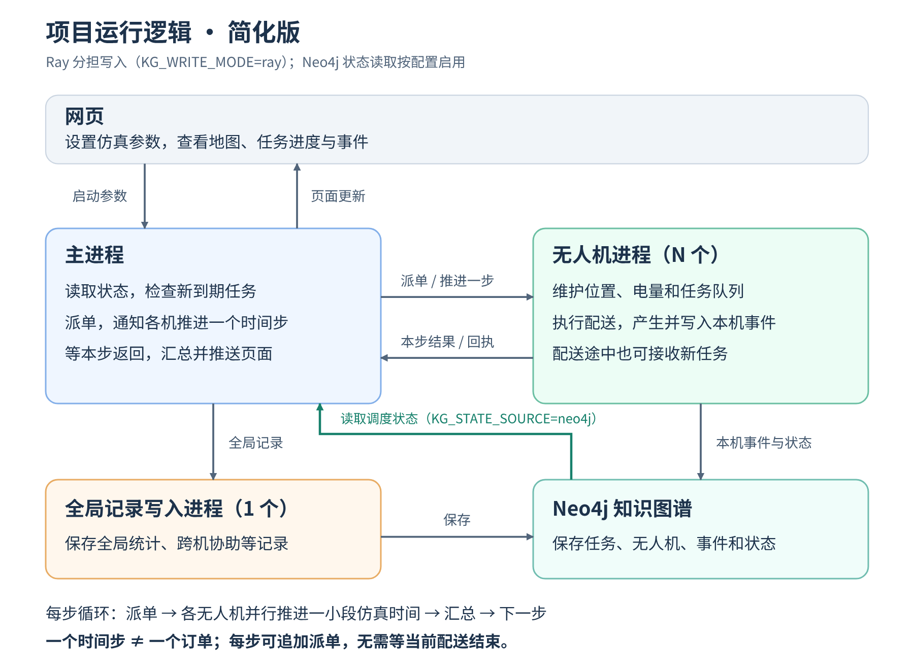

### 任务背景

用户希望简化已有项目运行逻辑图，只保留关键职责和数据流。继续采用原图的 Ray 仿真 + `KG_WRITE_MODE=ray` 模式，保留详细版并新增简化版。后续根据用户反馈补回被简化掉的 Neo4j 调度状态读取路径。

### 关键结论

- 图中仅保留网页、主进程、N 个无人机进程、1 个全局记录写入进程、Neo4j 五个部分。
- 主进程读取状态、检查到期任务、派单、推进时间步、等待本步结果并汇总推送页面。
- 无人机维护本机状态、执行配送、产生并写入本机事件；满足接单条件时，配送途中可追加任务。
- 全局记录写入进程在此图中仍是 Ray 知识写入 actor，负责全局统计、跨机协助等记录；不是 `KG_WRITE_MODE=process` 的统一写入子进程。
- 每步只推进一段仿真时间，不要求订单送达；下一步仍可派单。这条说明保留在图底部，避免将“本步返回”误解为“配送完成”。
- 显式保留绿色的“Neo4j → 主进程”箭头：当 `KG_STATE_SOURCE=neo4j` 时读取完整调度状态，供任务分配和协助判断使用。写入模式与读取来源是独立配置；仅设置 `KG_WRITE_MODE=ray` 不表示自动从 Neo4j 读取状态。
- 选择 `KG_STATE_SOURCE=ray` 时，主进程直接通过 Ray 获取快照；该分支及版本校验、LLM、初始化、检查点、资源清理等细节不在简化图中展开，详见原说明。

[SVG 矢量版](28-项目运行逻辑简化图.svg) · [详细运行说明](28-项目当前运行逻辑说明.md)

### 执行过的操作

- 查看原 SVG、原说明文件及本地 Playwright 图片导出脚本。
- 根据前面已经核对的运行职责绘制新 SVG，未重新启动仿真或访问数据库。
- 运行 `node /tmp/lade_runtime_diagram_simple_20261028.cjs` 导出 PNG，检查画布内文字边界，并查看生成图片。
- 根据用户反馈，在 SVG 中增加 Neo4j 到主进程的绿色状态读取箭头及参数标注，再次导出并检查 PNG。

### 修改内容

- 新增 `28-项目运行逻辑简化图.svg` 与 PNG：压缩为五个模块，仅保留关键职责、数据流与时间步提示。
- 新增本总结文件；详细图、业务代码和实验数据均未改动。
- 后续修订简化图和本说明：恢复关键的数据库读取数据流，仍保留五个模块。

### 后续建议

- 日常讲解使用简化图，需要了解参数和同步细节时再查看详细说明。
- 若展示 `KG_WRITE_MODE=process`，应改为专用子进程统一写入，不能原样使用本图的写入箭头。
