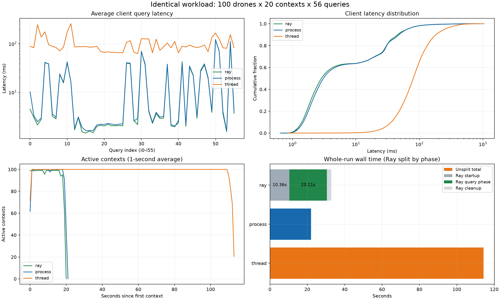

### 任务背景

用户提供 `test50ray`，要求解释 Ray 查询为何更快，并进一步贴出逐查询 avg/p95，强调需要与普通 Python 多进程查询比较。本次核对 Ray、同端点普通进程、线程，以及另一组不同端点的普通进程实验，避免比较基线混淆。

本次仅读取已有结果和代码，未重新启动查询压测、修改查询程序、连接数据库执行检查或变更索引。

### 关键结论

- Ray 的逐查询结果有效：112,000 条查询全部成功，100 个 Actor 在日志中对应 100 个不同 PID、100 个不同物理核心；全部查询记录的 CPU 绑定与 worker 信息一致。
- **对同样查询 61687 的 `test50`，Ray 单查询整体均值从 17.734 ms 降到 17.195 ms，降低约 3.04%。** 确实有部分查询改善更明显，例如 i0 从 10.225 ms 降到 4.489 ms、i2 从 2.475 ms 降到 2.123 ms；不能用总体 3% 概括每一条查询。
- 56 种查询中 51 种均值降低、5 种升高。Ray 与普通进程的总体延迟分布接近，不能将全部查询描述为新增数倍加速。
- 对线程组 `th_test50`，Ray 单查询均值快约 5.83 倍。大部分多进程收益在普通进程版已经出现；当前数据不能独立量化 Ray 框架或绑核的贡献。
- **另一份普通进程结果 `notest50/index_summary.json` 均值高达 813.774 ms，但查询的是 57687；Ray 查询的是 61687。** 若用户比较的是这一组，观察到的巨大差异存在，但同时改变了数据库端点，不能作为纯 Ray 加速结果。
- 项目既有部署与实验记录把 57687 映射为不带三组 AgentState 实验索引的 `lade`，61687 映射为带索引的 `lade-index`。文件名前缀 `index_` 与实际数据库组别并不一致。本次没有读取数据库当前索引状态，索引组别引用的是已有部署记录。
- Ray 整轮耗时 32.847 秒，比同端点普通进程的 22.024 秒长约 49.14%；Ray 其中启动 10.364 秒、查询阶段 20.113 秒、清理 2.369 秒。这个结论与部分单查询更快不矛盾，两者计时范围不同。

### 执行过的操作

- 读取四组 summary 和查询日志元数据，核对 `concurrency_mode`、URI、目录版本、run、step、参数及查询数。
- 对 `test50ray`、`test50`、`th_test50` 流式解析共 336,000 条查询记录和 6,000 包上下文；按任务键配对，比较参数、元数据、返回行数和完整查询结果。
- 从原始查询日志重算平均值及分位数，核对 summary 的三位小数统计；对每个 Ray 查询记录核验 PID、worker index、CPU ID 与 affinity。
- 从上下文开始时间、持续时间重建并发均值和启动分布，核对 Ray 分阶段耗时之和与整轮耗时一致。
- 追加核对 `notest50/index_query_logs.jsonl` 与 `index_contexts.jsonl`，单独区分 URI 差异与其他参数/结果差异。
- 阅读现有数据库部署记录与历史双库分析：
  - `docs/codex_notes/10/08-创建lade与lade-index查询库.md`
  - `docs/codex_notes/10/09-双库查询结果对比分析.md`
- 新增可复现分析脚本与数据：
  - [分析脚本](11-ray-query-result-analysis.py)
  - [对比数据 JSON](11-Ray查询结果对比数据.json)
  - [56 条查询 CSV](11-Ray查询结果对比数据.csv)
  - [同端点三组对比图](11-Ray查询结果对比数据.png)

复现命令，在仓库根目录执行：

```bash
MPLCONFIGDIR=/tmp/lade-query-analysis-mpl PYTHONDONTWRITEBYTECODE=1 \
  ./run_in_lade.sh /data/zc/apps/miniconda3/envs/roco/bin/python \
  docs/codex_notes/11/11-ray-query-result-analysis.py
```

统计与校验使用 Python 标准库，绘图使用已有 `roco` 环境的 matplotlib，未安装依赖。

### 修改内容

仅新增本报告、分析脚本及 JSON/CSV/PNG 分析产物，原始数据与查询代码均未修改。

#### 一、先明确比较的是哪份普通进程结果

| 结果文件 | 并发方式 | 日志记录的 URI 端口 | 查询均值 ms | 整轮耗时 s |
|---|---|---:|---:|---:|
| `test50ray/summary.json` | Ray 进程 | 61687 | 17.195 | 32.847 |
| `test50/summary.json` | 普通进程 | 61687 | 17.734 | 22.024 |
| `th_test50/summary.json` | 线程 | 61687 | 100.303 | 114.310 |
| `notest50/index_summary.json` | 普通进程 | 57687 | 813.774 | 926.155 |

四组均为 100 个 drone，每个重复 20 次，每包 56 条查询，合计 112,000 条查询，全部成功。run 均为 `hangzhou-0621-headless-002`，step 均为 2300。不同端点与不同实验时段仍会影响可比较性。

逐条比对确认：同端点的 Ray、普通进程、线程三组，参数和记录元数据一致，返回行数一致，完整上下文中的结果内容与行顺序也一致。每组累计返回 173,140 行，空结果调用均为 35,260 次。

追加核对另一端点的普通进程组后，112,000 个查询任务及 2,000 包上下文同样完整配对；排除 URI 后的参数与元数据差异为 0，返回行数差异为 0，完整上下文查询结果差异为 0。这说明两库返回同样的数据，但不同端点的执行环境和访问路径仍可能有巨大差异，不能把输出相同视为性能条件相同。

日志没有记录完整 Cypher 文本，因此不能追溯运行时语句的逐字版本；能确认的是目录版本 `i56-observed-graph-v2`、查询标识、参数、数据源与输出。

#### 二、用户贴出的逐查询结果如何对照

以下都是同一条查询的 avg，单位 ms；不要把不同查询、不同端点或 p95 与 avg 混合比较。

| 查询 | Ray，61687 | 普通进程，61687 | 线程，61687 | 普通进程，57687 |
|---|---:|---:|---:|---:|
| i0 | 4.489 | 10.225 | 88.685 | 50.134 |
| i1 | 3.028 | 3.320 | 82.507 | 1324.743 |
| i2 | 2.123 | 2.475 | 247.173 | 1198.201 |
| i3 | 2.753 | 2.939 | 137.267 | 75.872 |
| i14 | 1.541 | 1.898 | 86.905 | 975.046 |
| i30 | 70.272 | 68.768 | 127.274 | 157.034 |
| i41 | 42.679 | 39.159 | 89.293 | 50.589 |
| i50 | 120.446 | 122.286 | 166.181 | 166.704 |
| i54 | 104.813 | 111.501 | 154.345 | 145.241 |

因此，有两种不同的事实：

- 若与 `test50` 比，Ray 的 i0 确实降低约 56.10%、i2 降低约 14.22%、i14 降低约 18.81%，但 i30、i41 等反而略高。整体查询均值降低 3.04%，是同端点 56 种查询的加权结果；本轮每种查询都是 2,000 次，权重相同。
- 若与 `notest50` 比，i1、i2 等确实出现数百倍差异，但端点由 57687 变为 61687。已有部署记录显示两组在 AgentState 业务索引方面不同，这会直接改变大量快照、轨迹和状态查询的访问成本。

对同端点结果，i2 的 p95 为普通进程 3.520 ms、Ray 3.259 ms，并非从数百毫秒降至 3.259 ms；数百毫秒对应的是线程组或另一数据库端点的结果。

#### 三、为什么不宜把整体提速归给 Ray 或绑核

普通进程版与 Ray 版都已经使用独立 Python 解释器和独立 Driver，都能利用多个 CPU 核。普通进程不绑核，也可以由操作系统分散到多个核心执行；Ray 绑核不是把原先单核执行突然改成 100 核执行。

相较线程版，两种进程方案均能减少同一解释器内的 GIL/Python 处理竞争，以及父线程日志编码和查询处理之间的竞争。这与普通进程和 Ray 的曲线接近、两者又明显低于线程的观察相符。但没有 CPU/GIL 等待与服务端计时，仍不能量化各部分贡献。

Ray 版本还同时改变了以下条件：

- 全部 Actor 与 Driver 初始化完成后才发出查询；普通进程版是在池启动、worker 逐步就绪期间分发任务。
- 每个 Actor 绑定到不同物理核心，而普通进程版不绑定。
- Ray 配置了 `OMP_NUM_THREADS=1`、`OPENBLAS_NUM_THREADS=1`、`MKL_NUM_THREADS=1`；本查询负载未测量这些设置是否产生实际收益，不能直接认为它们解释了差值。
- 主进程保持每个 Actor 最多一包任务在执行，完成后取回结果、写日志、再补发下一包；普通进程版把全部任务交给进程池。
- 两组在不同时间运行：普通进程约 11:11，Ray 约 15:20，缓存与其他系统负载也可能不同。

因此，本次观察不是只改变 Ray 或只改变 affinity 的受控实验。当前数据支持“Ray 和普通多进程性能接近，部分查询进一步改善”，不支持“绑核或 Ray 本身额外带来数倍整体提速”。

#### 四、i0 为何看起来改善很大

| i0 任务分组 | 普通进程均值 ms | Ray 均值 ms |
|---|---:|---:|
| 提交序号前 100 包 | 168.356 | 49.240 |
| 后续 1,900 包 | 1.902 | 2.133 |
| 全部 2,000 包 | 10.225 | 4.489 |

i0 的总体均值明显下降，主要差异集中在最初的任务批次，和初始化、首条查询、初始建连及启动阶段竞争相关。后续 1,900 包中，Ray 的 i0 并没有比普通进程更低。这里按提交序号分组，不把它视为严格同步轮次，也不能据此把差异全归于某一个初始化环节。

i0 对同端点“查询整体均值差值”的贡献约为 19%，所以它的 2.28 倍平均耗时比，不能代表全体查询都有相同加速。

#### 五、单查询与整轮耗时是不同问题

| 指标 | 线程，61687 | 普通进程，61687 | Ray，61687 |
|---|---:|---:|---:|
| 单查询平均 ms | 100.303 | 17.734 | 17.195 |
| 单查询 p50 ms | 79.957 | 3.073 | 2.859 |
| 单查询 p95 ms | 251.822 | 64.702 | 64.031 |
| 单查询 p99 ms | 419.757 | 138.154 | 134.831 |
| 上下文平均 ms | 5619.350 | 996.471 | 965.848 |
| 整轮耗时 s | 114.310 | 22.024 | 32.847 |
| 整轮吞吐 次/s | 979.794 | 5085.275 | 3409.728 |

Ray 耗时分解：

```text
启动、Actor 创建与 ready：10.364 秒
查询、结果回传与写日志：  20.113 秒
Driver/Actor/runtime 清理：2.369 秒
总计：                  32.847 秒
```

启动与清理合计约占 Ray 整轮时间的 38.77%。Ray 查询阶段吞吐约为 5,568.418 次/秒，但该值不含启动与关闭，不能直接拿它与普通进程 summary 中包含启动和关闭的吞吐当作完全同口径对照。

普通进程首包开始至末包结束的时间跨度约 21.098 秒，Ray 约 20.108 秒；对应平均活跃上下文约 94.46、96.07。两组主体阶段都接近 100 包任务并发，Ray 并非通过大幅减少工作并发来获得低延迟。

#### 六、CPU 绑定验证能证明什么

本轮 Ray 记录了 100 个启动 Actor、100 个有查询返回的 Actor，各处理 18—22 包任务。worker 信息显示 100 个不同物理核心，每 Actor 分配的 Ray CPU 资源为 1。逐条记录中的 CPU ID、affinity 与对应 worker 信息匹配。

这证明配置与绑定校验成立，不证明 100 个核心一直满载，也不证明这些核心不受其他系统进程影响。摘要中的 `system_cpu_exclusivity` 明确为 `false`。

#### 对比图与完整数据



图中仅绘制同一 61687 端点的三组，避免把不同数据库组别混成并发实现的纯对照。CSV 额外列出了另一组 57687 普通进程的均值和 p95，列名带 `process_57687`。

### 后续建议

- 首先确认用户所指“普通进程版”是 `test50` 还是 `notest50/index_summary.json`；两者结论不同，本文已分别列出可直接核对的数值。已在会话中发出该澄清问题。
- 要单独判断 Ray 和绑核的收益，固定同一个数据库端点、查询参数、数据版本、worker 数及连接池容量，交替重复执行，并控制启动/预热口径。
- 若要验证索引因素，可进一步只读检查两个数据库的当前索引与执行计划；本次未执行该检查，也没有按目录名称推断数据库是否带索引。
- 单查询延迟、查询阶段吞吐和整轮耗时应分别汇报。对于短任务，Ray 启动开销可能超过单查询小幅改善；对于常驻 Actor 的长期工作负载，需按实际生命周期重新评估。

原始查询逻辑、数据库和结果文件均未修改。当前数值分析已完成；最终归因应先统一比较基线，不能根据 Ray 单侧逐查询列表推导另一组耗时。
