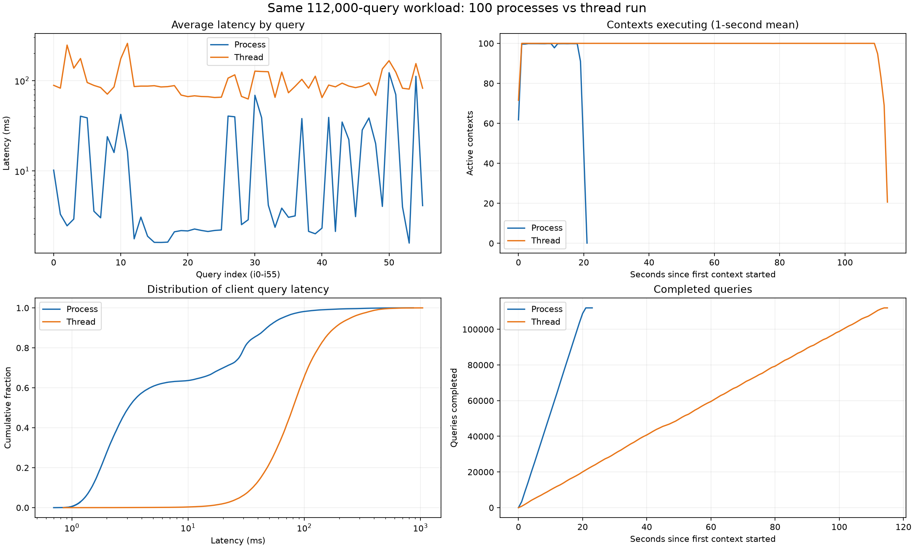

### 任务背景

用户希望分析线程并发与进程并发的查询时间差异，说明带 `th` 前缀的目录为线程实验、不带该前缀的目录为进程实验。用户写出的 `tests` 目录实际存放单元测试代码；本次找到对应结果目录 `test50`，据此比较：

- 进程组：[test50/summary.json](../../../test50/summary.json)、`query_logs.jsonl`、`contexts.jsonl`。
- 线程组：[th_test50/summary.json](../../../th_test50/summary.json)、`query_logs.jsonl`、`contexts.jsonl`。

本次只读取实验结果，未修改查询脚本、原始结果或数据库，也未重新运行数据库压测。

### 关键结论

- **本轮进程版整轮快约 5.19 倍**：线程版 114.310 秒，进程版 22.024 秒；总耗时减少 80.73%，吞吐由 979.794 提升到 5,085.275 次/秒。这是整轮执行的改善，包含进程启动和结果通信开销。
- 两组均为 **100 个 drone × 20 次上下文 × 56 条查询 = 112,000 条查询**，全部成功。目录中的 `50` 不代表实际只有 50 个 drone。
- 逐条匹配后，112,000 条查询的参数与记录元数据全部一致、返回行数全部一致；2,000 包上下文中每条查询返回的完整 JSON 内容及数组顺序也全部一致。每组累计返回 173,140 行。
- 单查询平均时间由 100.303 ms 降到 17.734 ms，改善 5.66 倍；中位数由 79.957 ms 降到 3.073 ms，改善 26.02 倍。进程组 56 种查询的平均延迟均低于线程组，其中 35 种查询平均小于 5 ms。
- 加速有明显类型差异：i2 约 99.86 倍，i3 约 46.70 倍，i32 约 29.95 倍；较重的 i50、i54 分别只有 1.36、1.38 倍。该模式支持客户端 Python/GIL/Driver 处理与协调竞争显著缓解的解释，但无法仅凭当前日志量化 GIL 的贡献。
- 根据上下文开始时间和持续时间重建，任务执行时间跨度内平均活跃上下文约为进程组 94.46、线程组 98.78；两组主体阶段均维持接近 100 包任务。进程启动错开、整体并发略低不足以解释本次 5 倍量级差距。
- 本轮线程实验在前、进程实验在后，未提供 CPU/GIL 剖析、服务端分阶段时间、完整启动命令或交替重复实验。数据库预热、系统负载和连接池协调的具体贡献仍待进一步区分。

### 执行过的操作

1. 使用 `rg --files --hidden --no-ignore` 定位结果文件并确认 `tests` 为代码目录、`test50` 为进程结果目录。
2. 读取两组 summary；流式解析两组共 224,000 条查询日志和 4,000 条上下文结果。
3. 以 `(context_index, query_index)` 配对查询，比较 drone、查询 ID/名称、目录版本、时间范围、参数、数据源、成功状态、返回行数等字段。
4. 对每包上下文的每条查询结果进行规范 JSON 的 SHA-256 比较，保留数组顺序；同时计算忽略结果行顺序的签名。两种比较均无差异。此处规范化只忽略 JSON 对象键的排列。
5. 从逐条日志重算均值、p50、p95、p99，与原 summary 对照，误差均在原统计的三位小数取整范围内；同时校验查询数、上下文数与摘要一致。
6. 用上下文开始时间加持续时间估算时间重叠，检查进程启动分布、任务分配及各重复批次的耗时。
7. 输出可复核的数据、逐查询 CSV、对比图及分析脚本：
   - [对比数据 JSON](11-线程进程查询对比数据.json)
   - [56 条查询对比 CSV](11-线程进程查询对比数据.csv)
   - [对比图 PNG](11-线程进程查询对比数据.png)
   - [分析脚本](11-context-concurrency-analysis.py)

主要分析通过 `./run_in_lade.sh python` 执行。`lade` 环境缺少 matplotlib，首次运行已完成统计 JSON/CSV，但在绘图时中止；随后使用现有 `roco` 环境完成同一分析和绘图，未安装依赖。可在仓库根目录复现：

```bash
MPLCONFIGDIR=/tmp/lade-query-analysis-mpl PYTHONDONTWRITEBYTECODE=1 \
  ./run_in_lade.sh /data/zc/apps/miniconda3/envs/roco/bin/python \
  docs/codex_notes/11/11-context-concurrency-analysis.py \
  --process-dir test50 \
  --thread-dir th_test50 \
  --output-prefix docs/codex_notes/11/11-线程进程查询对比数据
```

### 修改内容

新增本分析文档、对比数据 JSON、逐查询 CSV、对比图和可复现的分析脚本。原始实验数据与原查询程序均未修改。

#### 一、两组查询负载是否一致

| 项目 | 两组核对结果 |
|---|---|
| 目录版本 | `i56-observed-graph-v2` |
| Run | `hangzhou-0621-headless-002` |
| 连接地址 | `bolt://127.0.0.1:61687` |
| database 参数 | 均为 `null`，使用连接的默认数据库 |
| step / time_minute | 2300 / 634.0000000000523 |
| 历史 step 范围 | 2281—2300 |
| 事件时间窗口 | 604.0000000000523—634.0000000000523 |
| limit | 10 |
| drone / 重复 / 查询 | 100 / 每个 20 次 / i0—i55 |
| 全部任务配对 | 112,000 对，无重复任务键、无缺项 |
| 查询参数、元数据差异 | 0 |
| 返回行数差异 | 0 |
| 完整结果内容及行顺序差异 | 0 |
| 查询成功率 | 均为 100% |
| 累计结果行数 | 均为 173,140 |

两组都有 13 种查询在本数据场景中始终返回空列表；考虑其他查询的部分空结果后，每组共有 35,260 次空结果。这个比例在两组中完全一致，因此此次加速并非进程组额外出现了大量空返回。

日志未附带 Cypher 文本，无法对运行时语句进行逐字比较；可确认的是目录版本、查询标识、全部参数、结果和记录数量一致。线程组 summary 未记录 `max_workers` 和共享池上限，不能从摘要直接恢复其完整启动命令。

#### 二、总体时间对比

| 指标 | 线程 th_test50 | 进程 test50 | 改善倍数 |
|---|---:|---:|---:|
| 整轮 wall time | 114.310 s | 22.024 s | 5.19× |
| 吞吐 | 979.794 次/s | 5,085.275 次/s | 5.19× |
| 单查询平均 | 100.303 ms | 17.734 ms | 5.66× |
| 单查询 p50 | 79.957 ms | 3.073 ms | 26.02× |
| 单查询 p95 | 251.822 ms | 64.702 ms | 3.89× |
| 单查询 p99 | 419.757 ms | 138.154 ms | 3.04× |
| 整包上下文平均 | 5,619.350 ms | 996.471 ms | 5.64× |
| 整包上下文 p95 | 6,751.246 ms | 1,334.650 ms | 5.06× |

所有查询均成功，因此本轮吞吐也等于成功查询吞吐。

单查询 `elapsed_ms` 从调用 `session.run()` 前计时，直到全部结果读取和转换完成；它包含客户端、连接/网络与服务端的组合时间。进程版复用线程版同一个 `execute_context()`，两版单查询计时边界一致。

`wall_ms` 从创建池前计时，到池关闭后结束，包含进程启动、任务排队、结果传输和父进程写日志。因此，这次不能用“进程启动没计入单查询时间”来解释全部加速：整轮耗时本身也改善了 5.19 倍。

#### 三、哪些查询加速最多，哪些仍然慢

| 查询 | 主要内容 | 线程均值 ms | 进程均值 ms | 加速 |
|---|---|---:|---:|---:|
| i2 | 最近自身轨迹 | 247.173 | 2.475 | 99.86× |
| i15 | 自身历史状态样本汇总 | 87.802 | 1.623 | 54.08× |
| i3 | 当前任务 | 137.267 | 2.939 | 46.70× |
| i32 | 邻近同伴查询 | 125.317 | 4.184 | 29.95× |
| i1 | 最新自身快照 | 82.507 | 3.320 | 24.85× |
| i4 | 自身近期事件 | 175.490 | 40.368 | 4.35× |
| i30 | 近期完成任务 | 127.274 | 68.768 | 1.85× |
| i51 | 释放至完成耗时回顾 | 124.406 | 69.959 | 1.78× |
| i54 | 投递反馈关联 | 154.345 | 111.501 | 1.38× |
| i50 | 派单至取件反馈关联 | 166.181 | 122.286 | 1.36× |

完整 56 条查询均值、p50、p95、加速比及返回行数见 CSV。改善倍数是相同查询均值相除，不是把全部查询倍数做算术平均。

**i2 是重要证据。** 两组 i2 每次都返回 10 行、每组累计 20,000 行，结果内容完全相同。进程版并未少读取轨迹。线程组其中位数为 231.245 ms，进程组为 1.986 ms；差异覆盖典型请求，不只是少数超慢异常点拉高均值。

**较重查询的占比上升。** 在进程组所有查询累计计时中，i50 和 i54 合计约占 23.54%，线程组约占 5.71%。这表示客户端普遍开销降低后，复杂事件关联查询更突出，不意味着 i50/i54 在进程版退化。

进程版仍存在尾延迟：i50 的 p95 约为 439.015 ms，i54 的 p95 约为 214.775 ms。全体查询超过 200 ms 的次数由 9,183 次降到 623 次；超过 500 ms 的次数由 499 次降到 51 次。因此平均时间改善不代表所有查询均保持几毫秒。

#### 四、实际并发与启动开销能否解释差距

进程组摘要记录 100 个工作进程，全部返回过结果；每个进程处理 18—22 包任务，分布相对均衡。100 个进程的首次上下文开始时间跨度约 0.682 秒。

| 从日志重建的指标 | 线程 | 进程 |
|---|---:|---:|
| 首包开始到末包结束的时间跨度 | 113.777 s | 21.098 s |
| 上述跨度内平均活跃上下文 | 98.78 | 94.46 |
| 整轮 wall time 内平均活跃上下文 | 98.32 | 90.49 |
| wall time 减去上下文时间跨度 | 0.533 s | 0.927 s |

计算方法是把各包的 `total_elapsed_ms` 相加，再除以对应时间范围；每包都在工作线程或进程中持续执行，因此该值表示平均有多少包处于执行区间，不等于服务端同时运行多少条 Cypher。

图中的逐秒平均值显示，两组主体阶段都接近 100 包同时处理。进程组略低，包含启动、结束收尾及任务间空隙的影响。总体差距不能主要归因于进程组把并发从 100 降到了很小的数值。

时间戳只有毫秒精度，开始时间和 `perf_counter()` 采样之间也有微小间隔。数据 JSON 中由边界扫描得到的瞬时重叠峰值会出现 101、112 等超过 100 的伪峰，不能作为真实并发上限使用；此处仅采用更稳定的积分均值和逐秒趋势。

进程组实际设置的 `max_connection_pool_size_per_process` 为 100，但每个进程每次仅执行一包、包内查询串行，所以这不代表创建了 10,000 条工作连接或同时执行 10,000 条查询。线程版共享 Driver 也不代表共享一条连接。当前日志没有记录物理连接数，无法直接量化连接池变化的贡献。

#### 五、为什么更像客户端竞争缓解

代码层面的区别是：线程版共享一个解释器与 Driver，进程版每个工作进程有自己的解释器与 Driver。前一轮环境核查确认 `lade` 使用 Python 3.13.13，GIL 开启，Neo4j Driver 为 6.2.0。

传统带 GIL 的 CPython 可以让多个线程并发等待网络 I/O，但多个线程执行 Python 字节码时仍共享 GIL。[Python 官方文档](https://docs.python.org/3.12/library/threading.html)说明了这两个条件。Driver 结果处理、Python 迭代和字典构造，以及父线程写日志前的 JSON 编码，均可能影响高并发客户端的响应完成时间。不同工作进程可以在多个 CPU 核上处理这些任务，并减少共享连接池协调。

这与本轮现象相符：35 种查询在进程版均值不足 5 ms，而线程版每一种查询都超过 60 ms；轻查询普遍大幅改善，较重的事件关联查询只小幅改善。i2 读取相同 10 行结果，却从约 247 ms 降到约 2.5 ms，也说明旧的客户端观测延迟不能直接理解为数据库必然要计算 247 ms。

但当前两版日志均没有 `result_available_after`、`result_consumed_after`、CPU 使用率、GIL 等待或连接池等待的独立测量。不能把“线程均值减去进程均值”全算成 GIL 时间，也不能据此认定 Neo4j 服务端本身优化了约 100 倍。

#### 六、首次建连与实验顺序的影响

按任务提交序号分组，前 100 包中的 i0 平均：线程约 144.990 ms，进程约 168.356 ms。后续 1,900 包的 i0 平均：线程约 85.722 ms，进程约 1.902 ms。初始任务的连接与初始化成本在进程版中确实存在，没有被所有统计完全隐藏。

i2 在后续 1,900 包中的平均值仍为线程约 252.159 ms、进程约 2.223 ms，巨大差距持续存在。按每 100 个提交任务分成 20 个批次，剔除首末批后，两组上下文均值约为线程 5,677.736 ms、进程 996.937 ms，仍相差约 5.70 倍。批次并非同步轮次，此处理只用于排除首尾阶段主导结论的可能性。

从日志恢复的执行时段为：

- 线程组：2026-11-11 11:08:07.001 至 11:10:00.778 左右。
- 进程组：2026-11-11 11:11:46.396 至 11:12:07.494 左右。

进程组执行在后，可能受益于线程组预热过的缓存。线程组自身已重复 20 次，差距也并未只出现在首批，因此“冷启动一次”难以单独解释全部结果；但在缺少交替实验和服务端统计的情况下，不能彻底排除缓存与系统负载的影响。

#### 对比图



图中时间轴均从各组首包上下文开始归零，不是两个实验在同一时刻运行；它不包含池启动前后全部边界成本，整轮耗时以 summary 的 `wall_ms` 为准。

### 后续建议

1. 现有数据已足以确认：在这两次匹配的查询负载下，进程版客户端平均延迟和整轮吞吐均显著改善；不应把此结论推广为所有 Neo4j 查询都必然有相同加速。
2. 若要最终归因，保持同一数据库、查询参数和数据版本，先分别预热，再按线程→进程→进程→线程交替执行多轮，显式记录 worker 数、共享或每进程连接池上限。
3. 配合采集客户端各核 CPU、服务端处理时间以及连接数/等待信息。将 GIL/Driver 客户端竞争与服务器排队、缓存和其他负载分开，避免把所有差值都归给 GIL。
4. 后续优化优先检查 i50、i54 的执行计划与 Event 访问/关联成本；它们已经成为进程版中更突出的慢查询。先做针对性 PROFILE，再根据实际访问路径决定是否调整查询或索引。

本次只读分析已完成，无需额外授权。唯一的路径假设是将用户所写 `tests` 理解为实际存在且明确标记进程结果的 `test50`；若用户另有所指，应按指定目录重新比较。
